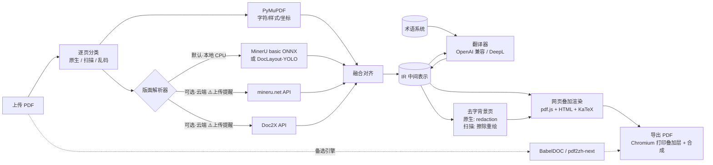

# 自建网页端 PDF 翻译 · 技术选型

> 日期：2026-10-28（v2，已纳入当天确认的需求）
> 依据：[00-research.md](00-research.md)
> 状态：草案。§8 验证实验完成后转为正式决策

---

## 1. 需求

| # | 需求 | 说明 |
|---|---|---|
| R1 | 网页端使用 | 上传 PDF → 浏览器里原文/译文对照阅读，类似沉浸式翻译 |
| R2 | 整体保留原版式 | 译文按原位置、原字号风格排回页面，图片和矢量图形不动 |
| R3 | 公式、图表重新渲染 | 公式不被翻坏；行内公式随译文重新排布；表格、图内文字可翻译并重新渲染 |
| R4 | 可接外部 API | 翻译：任意 OpenAI 兼容 LLM，可选 DeepL；解析：MinerU 云端 API（可选）、Doc2X（可选） |
| R5 | 自用、非商用 | 可使用 AGPL 组件（PyMuPDF、BabelDOC）；代码仓库公开 |
| R6 | 可导出 | 导出纯译文 PDF、双语对照 PDF |
| R7 | **论文术语一致** | 以学术论文为主，引入领域术语库 + 文档级术语抽取 |
| R8 | **通用输入** | 原生文本 PDF、扫描件、混合文档、文字提取乱码的 PDF 都要能处理 |
| R9 | **翻译方向** | 其他语言 → 简体中文，英文为主 |
| R10 | **云端上传要提醒** | 选择云端解析时，明确告知用户文件会上传到第三方 |

**约束**：部署机器**没有 GPU**，本地只跑 CPU 推理。

非目标（当前阶段）：多租户、计费、中文译成其他语言、Word/PPT 等非 PDF 格式。

---

## 2. 总体思路

**保版式 = 字符级坐标 + 版面语义 + 好的排版引擎**，分别交给最擅长的组件：

| 能力 | 交给谁 | 理由 |
|---|---|---|
| 字符级坐标、字体、字号、颜色 | **PyMuPDF** | 原生文本 PDF 坐标直接取自文件，零误差、CPU 秒级 |
| 版面语义（块类型、阅读顺序、公式 LaTeX、表格结构、OCR） | **本地 CPU 解析器** 或 **云端 MinerU / Doc2X** | 可插拔；无 GPU 时重型识别交给云端（需提醒） |
| 排版（换行、缩放、公式渲染） | **浏览器**（HTML/CSS + KaTeX） | 排版能力远强于在 PDF 里手写绘制指令，还能逐段编辑 |
| 术语一致 | **术语系统**（领域词库 + 文档抽取 + 命中注入） | 见 §4.5 |



**为什么不直接用 BabelDOC？** 它只产出 PDF，API 是内部接口，难以做网页上的逐段编辑、重翻、对照联动；也接不了 MinerU/Doc2X 的结构结果。但它效果是现成的，**作为基线和备选引擎接入**（BabelDOC 本身在 CPU 上就能跑）。

**为什么不走"转 Markdown 再翻"？** 丢原版式，不满足 R2。只取 MinerU/Doc2X 的**结构**（LaTeX、表格 HTML、阅读顺序），不取它们的 Markdown 排版。

---

## 3. 技术栈总表

| 层 | 选型 | 备选 | 说明 |
|---|---|---|---|
| 后端语言 | **Python 3.12** + uv | — | PDF/解析生态全在 Python |
| Web 框架 | **FastAPI** + Pydantic v2 | Litestar | IR 用 Pydantic 定义，可导出 JSON Schema 生成前端 TS 类型 |
| 任务执行 | **SQLite 任务表 + 进程内 worker**（asyncio + ProcessPool） | Redis + arq | 自用规模不必上 Redis；接口抽象好，以后可替换 |
| 进度推送 | **SSE** | WebSocket | 单向推送足够 |
| 数据库 | **SQLite**（SQLModel） | PostgreSQL | 任务、翻译缓存、术语库、API 配置 |
| 文件存储 | 本地目录 `data/jobs/<id>/` | — | 原文件、IR、背景页、导出物 |
| PDF 读写 | **PyMuPDF** | pikepdf | 文字提取、去字、叠加合成、栅格化 |
| 本地版面解析（CPU） | **MinerU basic + ONNX** | DocLayout-YOLO ONNX（只有块类型，更轻） | MinerU basic 约 0.8 GB 模型、最低 2 GB 内存、CPU 可跑；速度和公式/表格能力待 §8 S2 实测 |
| 云端版面解析（可选） | **mineru.net API** | Doc2X v3-2026（按页付费） | 公式密集、扫描件推荐；**每次使用弹出上传提醒** |
| 图像处理 | OpenCV（headless） | — | 扫描页文字擦除（inpaint）、颜色估计 |
| 翻译 | **OpenAI 兼容客户端**（官方 `openai` SDK + 自定义 base_url） | DeepL API | 覆盖 DeepSeek、通义千问、GLM、Kimi、硅基流动、OpenRouter、Ollama 等 |
| 术语匹配 | **pyahocorasick** + 简单词形归一 | — | 原文多模式匹配，见 §4.5 |
| 前端框架 | **React + Vite + TypeScript** | Vue 3 | — |
| PDF 渲染 | **pdfjs-dist**（直接用） | — | 需要精确控制 viewport 和坐标换算 |
| 公式渲染 | **KaTeX** | MathJax 3 | 快、同步、可打印；MathJax 作兜底 |
| 状态/请求 | Zustand + TanStack Query | — | — |
| 样式 | Tailwind CSS | — | — |
| PDF 导出 | **Playwright（Chromium）打印叠加层** + PyMuPDF 合成 | PyMuPDF `insert_htmlbox` | 见 §5.4 |
| 字体 | Noto Sans/Serif CJK SC | 用户自定义 | 前端 @font-face 与导出共用 |
| 部署 | **Docker Compose**：`web`（Caddy）+ `app`（API+worker）+ `mineru`（可选，CPU） | — | 见 §6 |

---

## 4. 后端设计

### 4.1 IR（中间表示）

统一坐标：**PDF point，左上角原点**（与 PyMuPDF 一致）。各解析器坐标在适配器里换算（单位需验证，见 §8 S2/S3）。

```python
class Span(BaseModel):          # 原生页来自 PyMuPDF；扫描页来自 OCR（样式为估算值）
    text: str
    bbox: Rect
    font: str | None
    size: float
    color: int
    flags: int                  # 粗体/斜体/上下标

class InlineFormula(BaseModel):
    id: str                     # 占位符 id，如 "m1"
    bbox: Rect
    latex: str | None           # 来自 MinerU/Doc2X
    crop: str | None            # 原图裁剪（兜底渲染）

class Block(BaseModel):
    id: str
    page: int
    type: Literal["text", "title", "list", "caption", "footnote",
                  "formula", "table", "figure", "header", "footer",
                  "reference", "code"]
    bbox: Rect
    order: int                  # 阅读顺序
    spans: list[Span] = []
    formulas: list[InlineFormula] = []
    latex: str | None = None    # 独立公式
    table_html: str | None = None
    style: BlockStyle           # 主字体、主字号、颜色、对齐、行距
    translatable: bool

class Segment(BaseModel):       # 翻译单元，可跨栏/跨页合并多个 Block
    id: str
    block_ids: list[str]
    source: str                 # 含占位符：'如 <m1/> 所示，<b>重要</b>'
    target: str | None
    terms: list[str] = []       # 命中的术语 id
    status: Literal["pending", "done", "failed", "edited"]

class Page(BaseModel):
    index: int
    width: float
    height: float
    rotation: int
    kind: Literal["native", "scanned", "garbled"]   # 见 §4.2
    blocks: list[Block]

class Document(BaseModel):
    pages: list[Page]
    segments: list[Segment]
    meta: DocMeta               # 标题、源语言、领域、解析器、是否用了云端
```

IR 落盘为 `ir.json`，每个阶段只读写 IR，可单独重跑（换翻译模型不必重新解析）。

### 4.2 逐页分类（通用输入的关键）

同一份 PDF 里可能混有原生页、扫描页、乱码页，所以**按页**判断走哪条路：

| 类型 | 判定（PyMuPDF，CPU 毫秒级） | 处理路径 |
|---|---|---|
| `native` 原生文本 | 有足量文字，且乱码字符比例低 | PyMuPDF 取字符 + 解析器给版面 → 融合 |
| `scanned` 扫描 | 几乎没有文字，且整页被大图覆盖 | 栅格化 → 解析器 OCR + 版面 → 样式估算 |
| `garbled` 提取乱码 | 有文字但大量 `U+FFFD`、私用区字符、无 ToUnicode 的 CID | **当作扫描页处理**（解决调研中的"CID 字体漏翻"问题） |

用户也可以在界面上强制某页走 OCR。

### 4.3 解析适配器

```python
class LayoutParser(Protocol):
    name: str
    is_cloud: bool              # True 时前端必须展示上传提醒
    async def parse(self, pdf: Path, pages: list[int], ocr_pages: list[int]) -> LayoutResult: ...
```

| 适配器 | 位置 | 何时用 | 备注 |
|---|---|---|---|
| `MinerULocalCPU` | 本地 | **默认** | `mineru server`（basic + ONNX）独立容器，HTTP 调用；含 OCR，扫描页也能处理，速度待实测 |
| `DocLayoutYOLO` | 本地 | MinerU CPU 太慢时的轻量方案 | 只给块类型，没有 LaTeX/OCR；BabelDOC 同款模型 |
| `MinerUCloud` | 云端 ⚠️ | 公式密集、扫描件、追求质量 | `MINERU_API_KEY`；用云端更强的模型拿 LaTeX 和表格 |
| `Doc2X` | 云端 ⚠️ | 公式质量要求最高 | ¥0.01–0.02/页；v3-2026 返回带坐标的版面块；结果 24h 过期需立即取回 |

**融合对齐**（`fusion.py`，原生页）：

1. PyMuPDF `page.get_text("rawdict")` 取字符/span。
2. 版面块与 span 按 bbox 重叠率归属；未被任何块覆盖的 span 自成文本块（防漏翻）。
3. 块类型、阅读顺序、LaTeX、表格 HTML 取自解析器；文字和样式以 PyMuPDF 为准。
4. 行内公式：文本块内被标为公式的区域 → `InlineFormula` + 占位符。
5. 跨栏/跨页段落合并：上一块末尾无句末标点 + 下一块同字号、首字母小写 → 合并为同一 Segment。

**扫描页**：文字和行框来自 OCR；字号 ≈ 行高 × 系数；颜色取行内深色像素中位数；字体统一映射为衬线/无衬线。

### 4.4 翻译

```python
class Translator(Protocol):
    async def translate(self, batch: list[Segment], ctx: TranslateContext) -> list[str]: ...
```

- **方向固定为 → 简体中文**。源语言自动识别（LLM 顺带判断即可，无需单独模型），记录在 `DocMeta`；英文以外的源语言暂不提供术语库。
- **OpenAI 兼容为主**：配置 `base_url`、`api_key`、`model`、`max_concurrency`、`rpm`。
- **批量 + 上下文**：每次请求打包相邻多个 Segment（按 token 预算），要求 JSON 返回 `{id: 译文}`；系统提示词带标题、摘要、领域和**本批命中的术语**。
- **中文输出规范**：学术书面语；中文标点；中英文之间加空格（可选）；数字、单位、引用编号原样保留。
- **占位符用 XML 风格**（`<m1/>`、`<b>…</b>`），返回后校验占位符集合一致，不一致单条重试，仍失败标 `failed` 保留原文。
- **缓存**：`sha256(source + model + prompt_version + glossary_hash)` → 译文。
- **限流与重试**：信号量控并发，令牌桶控 RPM，指数退避；记录 token 用量。
- **API Key**：`.env` 或 SQLite（本机加密），前端只显示掩码；不入 Git。

### 4.5 术语系统（论文场景）

参考 BabelDOC（文档自动抽取 + CSV 术语表）、GIST（领域术语库 + 提示词注入）、Kim et al.（trie 匹配后只注入命中项），设计为**五层来源，优先级从高到低**：

| 优先级 | 来源 | 说明 |
|---|---|---|
| 1 | **文档内锁定** | 用户在本篇里手动改过的译法，只对本篇生效 |
| 2 | **用户术语表** | 界面维护或 CSV 导入，兼容 BabelDOC 格式 `source,target,tgt_lng` |
| 3 | **文档自动抽取** | 翻译前让 LLM 读标题、摘要、章节标题和高频名词短语，产出候选术语 + 译法；候选先查第 4、5 层，库里有就用库里的。可选"翻译前确认术语"步骤 |
| 4 | **领域词库包** | 提供下载脚本，统一转成内部格式；首批：**GIST AI 术语 6426 条**（Apache-2.0）、**机器之心 AI 术语库约 2442 条**（CC BY-NC-SA，只在本地下载，**不提交到公开仓库**）；按领域启用 |
| 5 | **Wikidata 在线兜底** | 第 3 层抽到、但 4 层没有的术语，用英文标签查中文标签（CC0）；结果缓存并标记"待确认" |

此外维护**不译清单**：模型名、数据集名、算法缩写（如 BERT、ImageNet、ResNet），由抽取阶段分类 + 正则（全大写缩写、驼峰词）识别，保持原文。可选"**首次出现写作 中文（English）**，之后只写中文"，符合中文学术写作习惯。

**匹配与注入**

- 原文先做小写和简单词形归一（复数、-ing/-ed 等规则），再用 Aho-Corasick 多模式匹配，最长匹配优先。
- 每个翻译批次只注入命中的术语（通常几条到几十条），不把整个词库塞进提示词。
- 领域自动判断：LLM 读标题摘要给出领域（或用 arXiv 分类号），决定启用哪些词库包。

**译后校验**

- 检查命中术语的指定译法是否出现在译文中；不一致的段落标黄，可一键按术语重翻。
- 术语面板：列出全文术语和实际译法分布；修改一个术语 → 批量重翻包含它的段落（走缓存外的新请求）。

**存储**：SQLite 表 `glossary_entries(source, source_norm, target, domain, origin, priority, note)`，第三方词库文件放 `glossaries/vendor/`（已在 `.gitignore`）。

### 4.6 去字背景页

**原生页**：对 `translatable` 块做 redaction，只删文字、不动图片和矢量图：

```python
page.add_redact_annot(block.bbox)
page.apply_redactions(
    images=fitz.PDF_REDACT_IMAGE_NONE,     # 不动图片
    graphics=fitz.PDF_REDACT_LINE_ART_NONE,# 不动矢量线条（表格线、图表）
    text=fitz.PDF_REDACT_TEXT_REMOVE,      # 只删文字
)
```

独立公式块不删，原样保留。按字符 bbox 判定删除，块框需略收缩，避免误删相邻公式字符。

**扫描页 / 乱码页**：页面本身就是图片，redaction 不适用。改为：栅格化（约 200 DPI）→ 对 OCR 文字框做擦除（背景均匀时用框边缘的中位色填充，不均匀时用 OpenCV `inpaint`）→ 作为该页背景图。

### 4.7 API 概要

| 方法 | 路径 | 作用 |
|---|---|---|
| POST | `/api/jobs` | 上传 PDF + 选项（解析器、翻译服务、页码范围、领域）；云端解析器需带 `cloud_consent=true` |
| GET | `/api/jobs/{id}/events` | SSE 进度（分类 → 解析 → 融合 → 术语 → 翻译 n/m → 背景页） |
| GET | `/api/jobs/{id}/ir` | 获取 IR（可按页分片） |
| GET | `/api/jobs/{id}/files/{name}` | 原文、背景页、导出物 |
| GET/PUT | `/api/jobs/{id}/terms` | 本篇术语（确认、修改、锁定） |
| PATCH | `/api/segments/{id}` | 手动修改译文 |
| POST | `/api/segments/{id}/retranslate` | 单段重翻 |
| POST | `/api/jobs/{id}/export` | 导出纯译文 / 双语 PDF |
| GET/PUT | `/api/settings/providers` | 外部 API 配置 |
| GET/PUT | `/api/glossaries` | 用户术语表、词库包启用状态 |

---

## 5. 前端与渲染

### 5.1 页面结构

```
┌──────────── 工具栏：缩放 / 双栏·单栏·只看译文 / 术语 / 导出 / 设置 ────────────┐
│  原文（pdf.js 渲染 original.pdf）  │  译文（叠加渲染）                         │
│                                  │  ┌ Layer 0：背景页（pdf.js 或背景图）        │
│   悬停段落 ↔ 右侧对应段落高亮       │  └ Layer 1：绝对定位的译文 HTML 块         │
│   同步滚动                        │     点击 → 原文 / 编辑 / 重翻 / 术语        │
└──────────────────────────────────┴──────────────────────────────────────────┘
```

- 只渲染可视区附近的页（虚拟列表），大文档不卡。
- 坐标换算：`css_px = pt × viewport.scale`；Layer 1 整体 `transform: scale()`，块内始终按 pt 排版，保证网页与导出一致。

**上传页的云端提醒（R10）**：选择 MinerU 云端或 Doc2X 时，弹出提示："本文件将上传至 ××（第三方服务）进行解析，请勿上传涉密或未公开文档"，需勾选确认后才能提交；任务详情里显示本次是否使用了云端服务。默认选中本地解析器。

### 5.2 公式与图表的渲染策略（R3）

| 元素 | 默认策略 | 备选 / 兜底 |
|---|---|---|
| **独立公式** | 不翻译，**保留原矢量** | 扫描件或原公式是低清图片时，用 LaTeX + KaTeX 重新渲染 |
| **行内公式** | `<m1/>` 替换为 **KaTeX 渲染的 LaTeX** | 无 LaTeX 或渲染失败 → 原公式区域裁剪图 |
| **表格（原生）** | 保留表格线，按单元格把译文叠回原位置 | 单元格放不下 → 用 `table_html` 整表重新渲染 |
| **表格（扫描）** | 用 `table_html` 翻译单元格后整表重新渲染 | — |
| **图内矢量文字**（坐标轴、图例） | 图区域内 PyMuPDF 能取到的 span 单独翻译，小字号叠加 | 可按文档关闭 |
| **图内栅格文字** | 后期：OCR 后叠加 | 当前不做 |
| **图注 / 表注** | 当普通文本块翻译 | — |

### 5.3 排版拟合

英译中通常变短，主要风险在其他语言和长术语；目标是"放进原 bbox，字号尽量接近原文"：

1. 初始字号 = 原文主字号，衬线/无衬线映射到 Noto Serif/Sans CJK，粗体斜体沿用。
2. 先调行距（1.0–1.3），再二分查找字号（下限 = 原字号 × 0.7），离屏 DOM 测量高度。
3. 仍放不下 → **向下方空白扩展**（同栏下方到下一块之间的空隙）。
4. 还放不下 → 触底字号 + 溢出标记，用户可展开或编辑。
5. 拟合结果写回 IR，导出时直接复用，保证所见即所得。

### 5.4 导出 PDF

**主方案：Chromium 打印叠加层 + PyMuPDF 合成**

1. Playwright 打开专用导出页，只渲染 Layer 1（透明背景、每页尺寸 = 原页 pt 尺寸、使用 IR 中的拟合结果）。
2. `page.pdf()` 输出 `overlay.pdf`（矢量文字，自动嵌入字体子集，KaTeX 公式也是矢量）。
3. PyMuPDF 逐页把叠加层 `show_pdf_page` 到背景页上 → **纯译文 PDF**。
4. 双语对照：双倍宽页面左原文右译文，或原文页、译文页交替。

**备选**：PyMuPDF `insert_htmlbox` 直接排版（不支持 KaTeX，行内公式用裁剪图）；BabelDOC 引擎直接出 PDF（对比和兜底）。

---

## 6. 部署

```yaml
# docker-compose.yml（示意）
services:
  web:      # Caddy：静态前端 + 反向代理 + Basic Auth
  app:      # FastAPI + worker + Playwright Chromium + OpenCV + 字体
    volumes: ["./data:/data"]
  mineru:   # 可选：mineru server（basic + ONNX，纯 CPU）
```

- **无 GPU**：所有本地推理走 CPU。建议机器 ≥4 核、≥8 GB 内存（MinerU basic 最低 2 GB，加上 Chromium 和 worker）。
- 只在内网/Tailscale 访问，或用 Caddy Basic Auth，不做账号系统。
- 模型在构建镜像时预拉，走国内镜像（`HF_ENDPOINT=https://hf-mirror.com` 或 ModelScope）；字体打进镜像，避免调研中最常见的下载失败问题。
- 第三方词库在首次启动时由脚本下载到 `data/` 或 `glossaries/vendor/`，不进镜像也不进仓库。

---

## 7. 分阶段计划

| 阶段 | 内容 | 验收标准 |
|---|---|---|
| **P0 验证**（§8） | 跑通验证实验，选定本地解析器、导出方案 | 每个实验有结论写进文档 |
| **P1 MVP** | 原生 PDF：PyMuPDF + 本地 MinerU（CPU）/ 云端 MinerU（带提醒）→ IR → OpenAI 兼容翻译 → 网页双栏对照；GIST 词库 + 文档术语抽取；独立公式保留原样，行内公式用裁剪图 | 5 篇英文论文完整翻译，无漏页，正文版式不乱，核心术语前后一致 |
| **P2 可用** | KaTeX 行内公式、排版拟合与向下扩展、用户术语表与术语面板、翻译缓存、单段编辑/重翻、导出纯译文和双语 PDF | 导出 PDF 与网页视觉一致；同一文档二次打开不再调用 LLM |
| **P3 通用** | 逐页分类、扫描页/乱码页 OCR 路径与背景擦除、表格单元格翻译、图内矢量文字、跨页段落合并 | 白底扫描论文和混合文档可用 |
| **P4 扩展** | Doc2X 适配器、DeepL 适配器、Wikidata 兜底、BabelDOC 备选引擎、更多领域词库包、书签目录保留 | — |

---

## 8. 验证实验（P0）

样本：自选 8–10 个公开 PDF，覆盖单栏/双栏论文、公式密集、表格多、图表多、扫描件、非英文（如日文/德文）论文各至少 1 个。

| # | 实验 | 要回答的问题 |
|---|---|---|
| S1 | pdf2zh-next / BabelDOC（CPU）跑全部样本 | 现成方案做到什么程度？作为对比基线 |
| S2 | MinerU basic + ONNX（CPU）与 mineru.net API 跑同样样本 | **CPU 每页耗时**；basic 是否有公式 LaTeX / 表格结构 / OCR；**bbox 单位与坐标系**；块类型枚举与字段名；云端相比好多少 |
| S3 | Doc2X v3-2026 跑 3 个公式密集样本 | 坐标格式；LaTeX 质量是否明显优于 MinerU 云端，值不值得付费 |
| S4 | 解析器块 ↔ PyMuPDF span 对齐 | 对齐准确率；漏归属 span 比例 |
| S5 | PyMuPDF redaction 只删文字；扫描页擦除 | 是否误删公式字符、表格线；擦除后背景是否干净 |
| S6 | Chromium 打印透明叠加层 + `show_pdf_page` 合成 | 是否全矢量、字体嵌入、坐标与网页一致、文件大小 |
| S7 | 3 篇 AI 论文：有/无术语系统各翻一次 | 核心术语一致率；GIST 命中率；注入后提示词长度与成本 |

---

## 9. 已确认事项与待定问题

**已确认（2026-10-28）**

| 问题 | 结论 |
|---|---|
| GPU | 没有。本地只跑 CPU，MinerU 云端 API 作为可选项 |
| 文档类型 | 以学术论文为主 → 引入论文术语系统（§4.5） |
| 扫描件 | 不确定占比 → 设计成通用：逐页分类，扫描页和乱码页走 OCR（§4.2） |
| 翻译方向 | 其他语言 → 简体中文，英文为主 |
| 云端解析 | 可以用，但每次都要提醒用户（§5.1） |
| 代码仓库 | 公开仓库 [weandy/doc-translator](https://github.com/weandy/doc-translator) |

**待定**

1. **开源许可证**：仓库已公开但还没有 LICENSE。代码会链接 PyMuPDF（AGPL-3.0），建议直接用 **AGPL-3.0**。
2. **部署机器配置**：CPU 核数和内存，决定本地 MinerU 是否够快（S2 后再定）。
3. **Doc2X 是否接入**：付费服务，S3 结果出来再决定。

---

## 10. 风险

| 风险 | 影响 | 缓解 |
|---|---|---|
| MinerU CPU 推理太慢 | 本地解析一篇论文要很久 | S2 实测；慢则改用 DocLayout-YOLO + PyMuPDF（原生页够用），公式/扫描页交给云端 |
| MinerU 4.0 输出 schema 文档不全、变化快 | 适配器反复改 | 适配器内判断 schema 版本；锁定版本；S2 先摸清 |
| 行内公式混排位置不准 | 公式错位、重叠 | 优先 KaTeX 随文字流动渲染，不按原坐标硬贴 |
| 扫描页样式估算不准 | 译文字号、颜色与原文有偏差 | 统一样式 + 允许手动调整；扫描件本来就不追求像素级还原 |
| 术语库译法不适合上下文 | 错译被强制统一 | 术语只作为"推荐译法"注入；术语面板可改；文档内锁定优先级最高 |
| 第三方词库许可 | 公开仓库误含 NC 数据 | 只提供下载脚本；`glossaries/vendor/` 已加入 `.gitignore` |
| LLM 改坏占位符或漏翻 | 公式丢失 | 占位符校验 + 单条重试 + 失败保留原文 |
| 云端 API 隐私 | 文档外泄 | 默认本地；云端每次确认；任务记录使用了哪个服务 |
| 许可 | 若将来对外提供服务，AGPL 要求公开源码，MinerU 要求署名 | 仓库本身公开，基本满足；对外开放服务前重新评估 |
