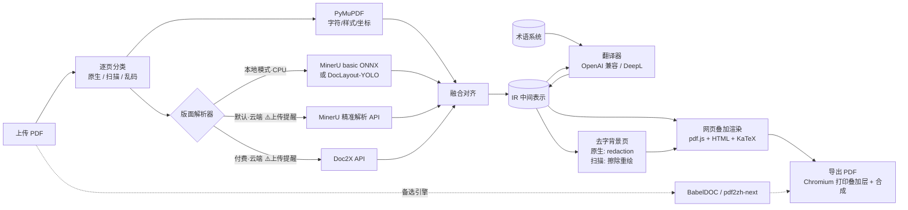

# 自建网页端 PDF 翻译 · 技术选型

> 日期：2026-10-28（v9：S11 公开数据集与开源项目调研确认默认不思考，精翻档适合非论文内容；v8：S10 验证 v2 提示词跨模型有效、v3 无提升；思考收益不稳定，默认不思考；v7 采用 v2 提示词；v6 质量纳入评判标准；v5 省 token 与 Key 存浏览器；v4 默认轻量模式）
> 依据：[00-research.md](00-research.md)
> 状态：验证实验已完成；第一阶段（P1）已按本选型实现并发布 v0.1.0，详见 [03-mvp-design.md](03-mvp-design.md)

---

## 1. 需求

| # | 需求 | 说明 |
|---|---|---|
| R1 | 网页端使用 | 上传 PDF → 浏览器里原文/译文对照阅读，类似沉浸式翻译 |
| R2 | 整体保留原版式 | 译文按原位置、原字号风格排回页面，图片和矢量图形不动 |
| R3 | 公式、图表重新渲染 | 公式不被翻坏；行内公式随译文重新排布；表格、图内文字可翻译并重新渲染 |
| R4 | 可接外部 API | 翻译：任意 OpenAI 兼容 LLM，可选 DeepL；解析：**MinerU 云端 API（默认）**、**Doc2X 付费 API（支持）** |
| R5 | **开源给大家自部署** | AGPL-3.0；一条 `docker compose up` 能跑起来；用户自带 API Key；可放心使用 AGPL 组件（PyMuPDF、BabelDOC） |
| R6 | 可导出 | 导出纯译文 PDF、双语对照 PDF |
| R7 | **论文术语一致** | 以学术论文为主，引入领域术语库 + 文档级术语抽取 |
| R8 | **通用输入** | 原生文本 PDF、扫描件、混合文档、文字提取乱码的 PDF 都要能处理 |
| R9 | **翻译方向** | 其他语言 → 简体中文，英文为主 |
| R10 | **云端上传要提醒** | 默认就是云端解析，所以每次上传都要明确告知文件会上传到哪个第三方，并提供切换到本地模式的入口 |
| R11 | **小机器能跑** | 默认模式不在本地跑模型，1 核 1 GB 级别的机器即可部署 |

**约束**：**不能假设有 GPU，也不能假设内存充足**（我们自己的机器 2 核 3.8 GB，跑 BabelDOC 单页就被 OOM，见 [02-spikes.md](02-spikes.md)）。因此重型的版面识别默认交给云端；本地模式只在 CPU 上跑，有 GPU 的用户可自行换用 MinerU 更强的等级。

### 1.1 两种运行模式

| | **轻量模式（默认）** | **本地模式（隐私选项）** |
|---|---|---|
| 版面解析 | MinerU 云端精准解析 API（免费，每天 1000 页优先额度）；可切换 Doc2X（付费，约 ¥0.02/页） | 本机 CPU 跑 MinerU basic（ONNX）或 DocLayout-YOLO |
| 文件去向 | PDF 上传到 MinerU / Doc2X（上传前提醒） | 不离开本机（翻译文本仍会发给所选 LLM） |
| 本地资源 | PyMuPDF + 浏览器排版，实测 2 页峰值约 150 MB | 至少 2 GB 空闲内存，推荐 4 核 8 GB |
| 需要的 Key | MinerU Token（或 Doc2X Key）+ LLM Key | 只要 LLM Key |

两种模式共用同一套 IR、翻译、渲染和导出，只是解析适配器不同；同一部署里可按任务切换。

非目标（当前阶段）：公共 SaaS、多租户、计费、中文译成其他语言、Word/PPT 等非 PDF 格式。

---

## 2. 总体思路

**保版式 = 字符级坐标 + 版面语义 + 好的排版引擎**，分别交给最擅长的组件：

| 能力 | 交给谁 | 理由 |
|---|---|---|
| 字符级坐标、字体、字号、颜色 | **PyMuPDF** | 原生文本 PDF 坐标直接取自文件，零误差、CPU 秒级 |
| 版面语义（块类型、阅读顺序、公式 LaTeX、表格结构、OCR） | **云端 MinerU（默认）/ Doc2X**，或本地 CPU 解析器 | 可插拔；默认交给云端，本地机器不跑模型 |
| 排版（换行、缩放、公式渲染） | **浏览器**（HTML/CSS + KaTeX） | 排版能力远强于在 PDF 里手写绘制指令，还能逐段编辑 |
| 术语一致 | **术语系统**（领域词库 + 文档抽取 + 命中注入） | 见 §4.5 |



**为什么不直接用 BabelDOC？** 它只产出 PDF，API 是内部接口，难以做网页上的逐段编辑、重翻、对照联动；也接不了 MinerU/Doc2X 的结构结果。但它效果是现成的，**作为基线和备选引擎接入**（BabelDOC 在 CPU 上能跑，但单页峰值内存约 1.5 GB，只适合本地模式）。

**为什么不走"转 Markdown 再翻"？** 丢原版式，不满足 R2。只取 MinerU/Doc2X 的**结构**（LaTeX、表格 HTML、阅读顺序），不取它们的 Markdown 排版。

---

## 3. 技术栈总表

| 层 | 选型 | 备选 | 说明 |
|---|---|---|---|
| 后端语言 | **Python 3.12** + uv | — | PDF/解析生态全在 Python |
| Web 框架 | **FastAPI** + Pydantic v2 | Litestar | IR 用 Pydantic 定义，可导出 JSON Schema 生成前端 TS 类型 |
| 任务执行 | **SQLite 任务表 + 进程内 worker**（asyncio + ProcessPool） | Redis + arq | 单实例自部署不必上 Redis；接口抽象好，以后可替换 |
| 进度推送 | **SSE** | WebSocket | 单向推送足够 |
| 数据库 | **SQLite**（标准库 sqlite3） | PostgreSQL | 任务、段落、翻译缓存 |
| 文件存储 | 本地目录 `data/jobs/<id>/` | — | 原文件、IR、背景页、导出物 |
| PDF 读写 | **PyMuPDF** | pikepdf | 文字提取、去字、叠加合成、栅格化 |
| 版面解析（默认，云端） | **MinerU 精准解析 API** | **Doc2X v3-2026 API**（付费） | MinerU 免费、每天 1000 页优先额度、单文件 ≤200 页（超出自动分段）；Doc2X ¥0.01–0.02/页；**上传前提醒** |
| 版面解析（本地模式，CPU） | MinerU basic + ONNX | DocLayout-YOLO ONNX（只有块类型，更轻） | MinerU basic 约 0.8 GB 模型、最低 2 GB 内存；速度待 §8 S2 实测 |
| 图像处理 | OpenCV（headless） | — | 扫描页文字擦除（inpaint）、颜色估计 |
| 翻译 | **OpenAI 兼容客户端**（官方 `openai` SDK + 自定义 base_url） | DeepL API | 覆盖 DeepSeek、通义千问、GLM、Kimi、硅基流动、OpenRouter、Ollama 等 |
| 术语匹配 | **pyahocorasick** + 简单词形归一 | — | 原文多模式匹配，见 §4.5 |
| 前端框架 | **React + Vite + TypeScript** | Vue 3 | — |
| PDF 渲染 | **pdfjs-dist**（直接用） | — | 需要精确控制 viewport 和坐标换算 |
| 公式渲染 | **KaTeX** | MathJax 3 | 快、同步、可打印；MathJax 作兜底 |
| 状态/请求 | Zustand + TanStack Query | — | — |
| 样式 | Tailwind CSS | — | — |
| PDF 导出 | **Playwright（Chromium）打印叠加层** + PyMuPDF 合成 | PyMuPDF `insert_htmlbox` | 见 §5.4 |
| 字体 | Noto Sans/Serif CJK SC | 用户自定义 | 前端 @font-face 与导出共用 |
| 部署 | **Docker Compose**：`web`（Caddy）+ `app`（API+worker）；本地模式另加 `mineru`（profile 可选） | — | 见 §6 |

---

## 4. 后端设计

### 4.1 IR（中间表示）

统一坐标：**PDF point，左上角原点**（与 PyMuPDF 一致）。各解析器坐标在适配器里换算（单位需验证，见 §8 S2/S3）。

```python
class Span(BaseModel):          # 原生页来自 PyMuPDF；扫描页来自 OCR（样式为估算值）
    text: str
    bbox: Rect
    font: str | None
    size: float
    color: int
    flags: int                  # 粗体/斜体/上下标

class InlineFormula(BaseModel):
    id: str                     # 占位符 id，如 "m1"
    bbox: Rect
    latex: str | None           # 来自 MinerU/Doc2X
    crop: str | None            # 原图裁剪（兜底渲染）

class Block(BaseModel):
    id: str
    page: int
    type: Literal["text", "title", "list", "caption", "footnote",
                  "formula", "table", "figure", "header", "footer",
                  "reference", "code"]
    bbox: Rect
    order: int                  # 阅读顺序
    spans: list[Span] = []
    formulas: list[InlineFormula] = []
    latex: str | None = None    # 独立公式
    table_html: str | None = None
    style: BlockStyle           # 主字体、主字号、颜色、对齐、行距
    translatable: bool

class Segment(BaseModel):       # 翻译单元，可跨栏/跨页合并多个 Block
    id: str
    block_ids: list[str]
    source: str                 # 含占位符：'如 <m1/> 所示，<b>重要</b>'
    target: str | None
    terms: list[str] = []       # 命中的术语 id
    status: Literal["pending", "done", "failed", "edited"]

class Page(BaseModel):
    index: int
    width: float
    height: float
    rotation: int
    kind: Literal["native", "scanned", "garbled"]   # 见 §4.2
    blocks: list[Block]

class Document(BaseModel):
    pages: list[Page]
    segments: list[Segment]
    meta: DocMeta               # 标题、源语言、领域、解析器、是否用了云端
```

IR 落盘为 `ir.json`，每个阶段只读写 IR，可单独重跑（换翻译模型不必重新解析）。

### 4.2 逐页分类（通用输入的关键）

同一份 PDF 里可能混有原生页、扫描页、乱码页，所以**按页**判断走哪条路：

| 类型 | 判定（PyMuPDF，CPU 毫秒级） | 处理路径 |
|---|---|---|
| `native` 原生文本 | 有足量文字，且乱码字符比例低 | PyMuPDF 取字符 + 解析器给版面 → 融合 |
| `scanned` 扫描 | 几乎没有文字，且整页被大图覆盖 | 栅格化 → 解析器 OCR + 版面 → 样式估算 |
| `garbled` 提取乱码 | 有文字但大量 `U+FFFD`、私用区字符、无 ToUnicode 的 CID | **当作扫描页处理**（解决调研中的"CID 字体漏翻"问题） |

用户也可以在界面上强制某页走 OCR。

### 4.3 解析适配器

```python
class LayoutParser(Protocol):
    name: str
    is_cloud: bool              # True 时前端必须展示上传提醒
    async def parse(self, pdf: Path, pages: list[int], ocr_pages: list[int]) -> LayoutResult: ...
```

| 适配器 | 位置 | 何时用 | 备注 |
|---|---|---|---|
| `MinerUCloud` | 云端 ⚠️ | **默认（轻量模式）** | `MINERU_API_TOKEN`；精准解析 API，开启公式、表格识别，扫描页开 OCR；单文件 >200 页自动按页码分段提交再合并；记录当日已用页数，接近 1000 页时提示"超出后排队变慢" |
| `Doc2X` | 云端 ⚠️ | 付费可选：公式质量要求最高、或 MinerU 额度/服务不可用 | `DOC2X_API_KEY`；v3-2026 返回带坐标的版面块；结果 24h 过期需立即取回；默认并发 10；不支持旋转 PDF（提交前先用 PyMuPDF 归正） |
| `MinerULocalCPU` | 本地 | 本地模式 | `mineru server`（basic + ONNX）独立容器，HTTP 调用；含 OCR |
| `DocLayoutYOLO` | 本地 | 本地模式、机器较小时 | 只给块类型，没有 LaTeX/OCR；BabelDOC 同款模型 |

**云端调用的公共处理**：上传前只截取需要的页（用户选了页码范围时不传整本）；提交—轮询—下载结果统一封装，失败重试并可一键改用另一个服务；下载的原始结果（Zip/JSON）存到 `data/jobs/<id>/parser/`，以后改进融合算法可直接重放，不必再上传。

**融合对齐**（`fusion.py`，原生页）：

1. PyMuPDF `page.get_text("rawdict")` 取字符/span。
2. 版面块与 span 按 bbox 重叠率归属；未被任何块覆盖的 span 自成文本块（防漏翻）。
3. 块类型、阅读顺序、LaTeX、表格 HTML 取自解析器；文字和样式以 PyMuPDF 为准。
4. 行内公式：文本块内被标为公式的区域 → `InlineFormula` + 占位符。
5. 跨栏/跨页段落合并：MinerU 已把续行并入上一块（续行坐标属于下一页），下一页留一个同位置的空块（S4 实测）。融合时按行的 y 坐标把块拆成"本页部分 + 下一页部分"，作为同一个 Segment 翻译，渲染时按原文行数比例在标点处拆分译文；本地解析器没有这种标记时，再用"上一块末尾无句末标点 + 下一块同字号、首字母小写"的规则合并。
6. 文字纠正：MinerU 文本偶有把重音符（如 `\hat`）识别成字母的情况，原生页以 PyMuPDF 提取的文字为准。

**扫描页**：文字和行框来自 OCR；字号 ≈ 行高 × 系数；颜色取行内深色像素中位数；字体统一映射为衬线/无衬线。

### 4.4 翻译

```python
class Translator(Protocol):
    async def translate(self, batch: list[Segment], ctx: TranslateContext) -> list[str]: ...
```

- **方向固定为 → 简体中文**。源语言自动识别（LLM 顺带判断即可，无需单独模型），记录在 `DocMeta`；英文以外的源语言暂不提供术语库。
- **OpenAI 兼容为主**：配置 `base_url`、`api_key`、`model`、`max_concurrency`、`rpm`。
- **批量 + 上下文**：每次请求打包相邻多个 Segment（按 token 预算），要求 JSON 返回 `{id: 译文}`；系统提示词带标题、摘要、领域和**本批命中的术语**。
- **中文输出规范**：学术书面语；中文标点；中英文之间加空格（可选）；数字、单位、引用编号原样保留。
- **占位符用 XML 风格**（`<m1/>`、`<b>…</b>`），返回后校验占位符集合一致，不一致单条重试，仍失败标 `failed` 保留原文。
- **缓存**：`sha256(source + model + prompt_version + glossary_hash)` → 译文。
- **限流与重试**：信号量控并发，令牌桶控 RPM，指数退避；记录 token 用量。
- **API Key 保存在用户浏览器**（见 §4.4.2），服务端不落盘。

#### 4.4.0 质量档位与提示词（见 [02-spikes.md S8–S10](02-spikes.md#s10通用提示词-v3--跨模型验证2026-10-28)）

评判标准：**先保证没有意思错误（误译、漏译、公式条件颠倒），再在质量相近的方案里选便宜的**。

**提示词基线用 v2**（[`spikes/s9_prompt.py`](../spikes/s9_prompt.py) 的 `RULES_V2`），它不依赖任何特定模型，S10 在 gpt-6-luna 上同样表现最好：
- 公式以 `<mN>LaTeX</mN>` 给模型看，输出只写 `<mN/>`；明确公式在数学陈述中的对应关系不能变（S9 中收益最大的一条：公式段 91.7 → 97.5）。
- 风格要求 + 一个示例（固定前缀，可命中缓存）；模型名及配置后缀、指标缩写保留原文。
- 术语表为“推荐译法”。术语抽取（[`spikes/s10_prompt_v3.py`](../spikes/s10_prompt_v3.py) 的 `TERMS_V3`）附带一句话“领域”，抽取后**程序校正**：按正文中最常见的写法改写，正文未出现或等于章节名的丢弃。
- 每批注明所在章节；温度 0.3（官方建议的 1.3 在公式文本上更容易出错）；如开思考只用 low。
- S10 测试过在 v2 上继续加规则（优先级、自检、更多保留条目）的 v3，**没有可测量的收益**；提示词已到收益递减点。

**质量档位**

| 档位 | 做法 | 依据 | 每篇费用（DeepSeek，空闲 / 高峰） |
|---|---|---|---|
| **默认** | v2 提示词、不思考 | 论文样本（S9/S10）和公开学术数据集 ACL 60/60（S11）上，思考均无稳定收益；主流开源翻译工具也默认关闭思考 | ¥0.035 / ¥0.07 |
| 精翻 | v2 提示词、思考·low | 通用/文学/口语内容（WMT24++）上明显更好（评审 95.5 → 97.1），学术内容上持平；适合非论文类文档或用户追求稳妥时 | ¥0.13 / ¥0.26 |
| 精修（单段按钮） | 不思考初译 + 思考审校，只改有问题的句子 | translation-agent / TEaR 思路 | 按段计费 |

- **模型选择要靠基准测试**：S10 中 gpt-6-luna 最高，S11 换成公开数据集后它最低，模型排名受数据集和评审方式影响很大。界面允许用户为“默认/精翻”分别选模型，项目提供基于 ACL 60/60 + WMT24++ 的基准脚本供对比。
- 文档类型自动判断（论文 / 非论文）后，可对非论文类文档默认建议“精翻”。
- Pro 模型只作为用户手动选择的选项（S8：不比 Flash 思考更好，更贵）。
- 提示词或模型的任何改动都要重跑回归测试再上线：①论文样本 30 段（含留出论文 10 段）；②公开数据集 ACL 60/60（160 句）+ WMT24++（40 段），算 BLEU/chrF++ 并带参考译文评审；评审用强模型高推理档 + Claude 盲评，只采信多种评审方向一致的结论。样本由脚本按固定随机种子从样本论文生成（论文原文不入库），评审脚本随仓库保留。

#### 4.4.1 省 token 策略（已用 DeepSeek 实测，见 [02-spikes.md](02-spikes.md#s7一篇论文的翻译开销2026-10-28)）

实测结论：按 DeepSeek Flash 价格，**输出 token 占费用约 75%**，输入侧的固定说明在大批次下只占约 20%。在保证 §4.4.0 质量档位的前提下，按效果排序：

| # | 策略 | 实测/预估效果 | 参考来源 |
|---|---|---|---|
| 1 | **默认不思考** | DeepSeek V4 默认开启思考，推理 token 约为正文输出的 4–5 倍且按输出计费；v2 提示词下思考的质量收益小且不稳定（S9/S10），只在“精翻”档开 | DeepSeek 文档、S8–S10 实测 |
| 2 | **只翻该翻的** | 参考文献默认不翻（两篇论文分别占可翻文本的 15%、26%，可在界面开启）；公式、算法框、图表、页眉页码直接跳过；纯数字/少于 2 个单词的片段跳过 | MinerU 已给出块类型 |
| 3 | **大批次 + 紧凑行格式** | 每批约 1500 token 原文，「编号\|原文」一行一段，只要求输出「编号\|译文」，不回显原文、不用缩进 JSON。输入 token 比逐段请求或 BabelDOC 式小批次（≤200 token/批）**少约 64%**（8.2k vs 22.6k–23.8k） | 对比 BabelDOC `il_translator_llm_only` |
| 4 | **术语只抽一次、只看摘要和章节标题** | 一次约 600 token 的小调用；本地词库（GIST）匹配不花 token。BabelDOC 的自动术语抽取会扫全文 | BabelDOC AutoTermExtractor |
| 5 | **译文缓存 + 去重** | 同段落（含跨文档、重复页眉）只翻一次；重开文档、换渲染方式、导出都不再花钱；单段重翻只发这一段 | BabelDOC 翻译缓存 |
| 6 | **失败只重试失败段落** | 占位符校验不通过的段落单独重试，不整批重来；`max_tokens = 2 × 输入 + 200` 防止失控输出 | — |
| 7 | **默认 Flash，Pro 只用于"精翻"** | Pro 价格约为 Flash 的 3.4 倍，作为单段/整篇的可选升级 | — |
| 8 | **空闲时段半价**（可选） | DeepSeek 工作日 9–12、14–18 点外半价；非急用任务可勾选"闲时翻译"排队 | DeepSeek 价格页 |
| 9 | **固定前缀利用上下文缓存** | 系统提示（规则 + 标题摘要 + 全文术语表）在同一文档内完全一致，放在最前面；实测命中有限（0–512 token），收益小但零成本 | DeepSeek 上下文硬盘缓存 |
| 10 | **开始前预估费用** | 按 token 数 × 当前时段价格显示预计花费，用户确认后再翻 | — |

#### 4.4.2 API Key 存储（开源部署）

- 用户在设置页填写的 Key（LLM、MinerU、Doc2X）**只保存在该用户浏览器的 localStorage**，每次创建任务时随请求以请求头发给后端。
- 后端只把 Key 放在内存里供本次任务使用，**不写数据库、不写日志、不写磁盘**；任务结束即丢弃。服务重启导致任务中断时，前端重新提交 Key 继续。
- 部署者也可以在 `.env` 里配置共享 Key（自己用或给团队用），浏览器里填写的优先。
- 安全措施：严格 CSP、不加载第三方脚本（降低 XSS 窃取 localStorage 的风险）；设置页提供"清除已保存的 Key"；界面提示"不要在公用电脑上保存 Key"；部署在公网必须走 HTTPS。

### 4.5 术语系统（论文场景）

参考 BabelDOC（文档自动抽取 + CSV 术语表）、GIST（领域术语库 + 提示词注入）、Kim et al.（trie 匹配后只注入命中项），设计为**五层来源，优先级从高到低**：

| 优先级 | 来源 | 说明 |
|---|---|---|
| 1 | **文档内锁定** | 用户在本篇里手动改过的译法，只对本篇生效 |
| 2 | **用户术语表** | 界面维护或 CSV 导入，兼容 BabelDOC 格式 `source,target,tgt_lng` |
| 3 | **文档自动抽取** | 翻译前让 LLM 读标题、摘要、章节标题和高频名词短语，产出候选术语 + 译法；候选先查第 4、5 层，库里有就用库里的。可选"翻译前确认术语"步骤 |
| 4 | **领域词库包** | 提供下载脚本，统一转成内部格式；首批：**GIST AI 术语 6426 条**（Apache-2.0，可再分发，需保留署名）；按领域启用。机器之心 AI 术语库为 CC BY-NC-SA，**不集成**，只在 README 里给出链接供人工查阅 |
| 5 | **Wikidata 在线兜底** | 第 3 层抽到、但 4 层没有的术语，用英文标签查中文标签（CC0）；结果缓存并标记"待确认" |

此外维护**不译清单**：模型名、数据集名、算法缩写（如 BERT、ImageNet、ResNet），由抽取阶段分类 + 正则（全大写缩写、驼峰词）识别，保持原文。可选"**首次出现写作 中文（English）**，之后只写中文"，符合中文学术写作习惯。

**匹配与注入**

- 原文先做小写和简单词形归一（复数、-ing/-ed 等规则），再用 Aho-Corasick 多模式匹配，最长匹配优先。
- 每个翻译批次只注入命中的术语（通常几条到几十条），不把整个词库塞进提示词。
- 领域自动判断：LLM 读标题摘要给出领域（或用 arXiv 分类号），决定启用哪些词库包。

**译后校验**

- 检查命中术语的指定译法是否出现在译文中；不一致的段落标黄，可一键按术语重翻。
- 术语面板：列出全文术语和实际译法分布；修改一个术语 → 批量重翻包含它的段落（走缓存外的新请求）。

**存储**：SQLite 表 `glossary_entries(source, source_norm, target, domain, origin, priority, note)`，下载的第三方词库文件放 `glossaries/vendor/`（已在 `.gitignore`），首次启动时由脚本下载。

### 4.6 去字背景页

**原生页**：对 `translatable` 块做 redaction，只删文字、不动图片和矢量图：

```python
page.add_redact_annot(block.bbox)
page.apply_redactions(
    images=fitz.PDF_REDACT_IMAGE_NONE,     # 不动图片
    graphics=fitz.PDF_REDACT_LINE_ART_REMOVE_IF_TOUCHED,  # 只删完全落在块内的线条（行内公式的分数线、根号），表格线和图表不受影响（S5 实测）
    text=fitz.PDF_REDACT_TEXT_REMOVE,      # 只删文字
)
```

独立公式块不删，原样保留。按字符 bbox 判定删除，块框需略收缩，避免误删相邻公式字符。

**扫描页 / 乱码页**：页面本身就是图片，redaction 不适用。改为：栅格化（约 200 DPI）→ 对 OCR 文字框做擦除（背景均匀时用框边缘的中位色填充，不均匀时用 OpenCV `inpaint`）→ 作为该页背景图。

### 4.7 API 概要

| 方法 | 路径 | 作用 |
|---|---|---|
| POST | `/api/jobs` | 上传 PDF + 选项（解析器、翻译服务、页码范围、领域）；云端解析器需带 `cloud_consent=true` |
| GET | `/api/parsers/usage` | 各云端解析服务的当日用量 / 余额（MinerU 已用页数、Doc2X 剩余页数） |
| GET | `/api/jobs/{id}/events` | SSE 进度（分类 → 解析 → 融合 → 术语 → 翻译 n/m → 背景页） |
| GET | `/api/jobs/{id}/ir` | 获取 IR（可按页分片） |
| GET | `/api/jobs/{id}/files/{name}` | 原文、背景页、导出物 |
| GET/PUT | `/api/jobs/{id}/terms` | 本篇术语（确认、修改、锁定） |
| PATCH | `/api/segments/{id}` | 手动修改译文 |
| POST | `/api/segments/{id}/retranslate` | 单段重翻 |
| POST | `/api/jobs/{id}/export` | 导出纯译文 / 双语 PDF |
| GET | `/api/settings/providers` | 服务端是否配置了共享 Key、可用模型列表（不返回 Key 本身）；用户 Key 在浏览器，随请求头 `X-LLM-Key` / `X-Parser-Key` 发送 |
| POST | `/api/jobs/estimate` | 按页数、token 数和当前时段价格预估费用 |
| GET/PUT | `/api/glossaries` | 用户术语表、词库包启用状态 |

---

## 5. 前端与渲染

### 5.1 页面结构

```
┌──────────── 工具栏：缩放 / 双栏·单栏·只看译文 / 术语 / 导出 / 设置 ────────────┐
│  原文（pdf.js 渲染 original.pdf）  │  译文（叠加渲染）                         │
│                                  │  ┌ Layer 0：背景页（pdf.js 或背景图）        │
│   悬停段落 ↔ 右侧对应段落高亮       │  └ Layer 1：绝对定位的译文 HTML 块         │
│   同步滚动                        │     点击 → 原文 / 编辑 / 重翻 / 术语        │
└──────────────────────────────────┴──────────────────────────────────────────┘
```

- 只渲染可视区附近的页（虚拟列表），大文档不卡。
- 坐标换算：`css_px = pt × viewport.scale`；Layer 1 整体 `transform: scale()`，块内始终按 pt 排版，保证网页与导出一致。

**上传页的云端提醒（R10）**：轻量模式是默认，所以提醒是常驻的：

- 上传区上方始终显示提示条："本文件将上传至 **MinerU 云端**（或 Doc2X）进行版面解析，请勿上传涉密或未公开文档"，旁边是"切换到本地模式"入口（本地模式未部署时显示部署说明链接）。
- 提交按钮旁有确认勾选框，**每次提交都要勾选**（`cloud_consent=true`）；首次使用额外弹窗说明各服务的隐私政策链接。
- 选 Doc2X 时同时显示预计费用（页数 × 单价）。
- 任务详情里记录本次使用了哪个服务。

### 5.2 公式与图表的渲染策略（R3）

| 元素 | 默认策略 | 备选 / 兜底 |
|---|---|---|
| **独立公式** | 不翻译，**保留原矢量** | 扫描件或原公式是低清图片时，用 LaTeX + KaTeX 重新渲染 |
| **行内公式** | `<m1/>` 替换为 **KaTeX 渲染的 LaTeX** | 无 LaTeX 或渲染失败 → 原公式区域裁剪图 |
| **表格（原生）** | 保留表格线，按单元格把译文叠回原位置 | 单元格放不下 → 用 `table_html` 整表重新渲染 |
| **表格（扫描）** | 用 `table_html` 翻译单元格后整表重新渲染 | — |
| **图内矢量文字**（坐标轴、图例） | 图区域内 PyMuPDF 能取到的 span 单独翻译，小字号叠加 | 可按文档关闭 |
| **图内栅格文字** | 后期：OCR 后叠加 | 当前不做 |
| **图注 / 表注** | 当普通文本块翻译 | — |

### 5.3 排版拟合

英译中通常变短，主要风险在其他语言和长术语；目标是"放进原 bbox，字号尽量接近原文"：

1. 初始字号 = 原文主字号，衬线/无衬线映射到 Noto Serif/Sans CJK，粗体斜体沿用。
2. 先调行距（1.0–1.3），再二分查找字号（下限 = 原字号 × 0.7），离屏 DOM 测量高度。
3. 仍放不下 → **向下方空白扩展**（同栏下方到下一块之间的空隙）。
4. 还放不下 → 触底字号 + 溢出标记，用户可展开或编辑。
5. 拟合结果写回 IR，导出时直接复用，保证所见即所得。

### 5.4 导出 PDF

**主方案：Chromium 打印叠加层 + PyMuPDF 合成**

1. Playwright 打开专用导出页，只渲染 Layer 1（透明背景、每页尺寸 = 原页 pt 尺寸、使用 IR 中的拟合结果）。
2. `page.pdf()` 输出 `overlay.pdf`（矢量文字，自动嵌入字体子集，KaTeX 公式也是矢量）。
3. PyMuPDF 逐页把叠加层 `show_pdf_page` 到背景页上 → **纯译文 PDF**。
4. 双语对照：双倍宽页面左原文右译文，或原文页、译文页交替。

**备选**：PyMuPDF `insert_htmlbox` 直接排版（不支持 KaTeX，行内公式用裁剪图）；BabelDOC 引擎直接出 PDF（对比和兜底）。

---

## 6. 部署

```yaml
# docker-compose.yml（示意）
services:
  web:      # Caddy：静态前端 + 反向代理 + Basic Auth
  app:      # FastAPI + worker + Playwright Chromium + OpenCV + 字体
    volumes: ["./data:/data"]
  mineru:   # 仅本地模式：mineru server（basic + ONNX，纯 CPU），profiles: ["local"]
```

- **轻量模式（默认）**：`docker compose up` 只起 `web` + `app`，本地不跑任何模型；最低约 1 核 / 1 GB，推荐 2 核 / 2 GB（主要是 Chromium 导出）。首次打开进入设置向导：填 MinerU Token（附免费申请链接）或 Doc2X Key，再填 LLM 的 base_url / Key / 模型。
- **本地模式**：`docker compose --profile local up`，额外起 `mineru` 容器；推荐 4 核 / 8 GB，最低 2 核 / 4 GB 空闲内存。
- 不做账号系统；部署在公网时用 Caddy Basic Auth（`.env` 配置用户名密码），内网/Tailscale 可关闭。
- 提供 `.env.example`：翻译服务、云端解析 Key、访问密码，全部由部署者自己填写，仓库里不含任何 Key。
- 界面“关于”页注明使用了 MinerU、PyMuPDF、BabelDOC 等组件（满足 MinerU 许可中“提供在线服务需署名”的要求）。
- 本地模式的模型在构建镜像时预拉，走国内镜像（`HF_ENDPOINT=https://hf-mirror.com` 或 ModelScope）；字体打进镜像（两种模式都需要），避免调研中最常见的下载失败问题。
- 第三方词库在首次启动时由脚本下载到 `glossaries/vendor/`，不进镜像也不进仓库。

---

## 7. 分阶段计划

> P1 的详细设计见 [03-mvp-design.md](03-mvp-design.md)。

| 阶段 | 内容 | 验收标准 |
|---|---|---|
| **P0 验证**（§8） | 跑通验证实验，摸清 MinerU 云端 / Doc2X 输出格式，确定导出方案 | 每个实验有结论写进文档 |
| **P1 MVP** | 原生 PDF：PyMuPDF + **MinerU 云端**（带提醒）→ IR → OpenAI 兼容翻译 → 网页双栏对照；GIST 词库 + 文档术语抽取；独立公式保留原样，行内公式用裁剪图 | 5 篇英文论文完整翻译，无漏页，正文版式不乱，核心术语前后一致 |
| **P2 可用** | KaTeX 行内公式、排版拟合与向下扩展、用户术语表与术语面板、翻译缓存、单段编辑/重翻、导出纯译文和双语 PDF、**Doc2X 适配器**、设置向导与用量显示 | 导出 PDF 与网页视觉一致；同一文档二次打开不再调用 LLM；MinerU 与 Doc2X 可随时切换 |
| **P3 通用** | 逐页分类、扫描页/乱码页 OCR 路径与背景擦除、表格单元格翻译、图内矢量文字、跨页段落合并 | 白底扫描论文和混合文档可用 |
| **P4 扩展** | 本地模式（MinerU CPU / DocLayout-YOLO）、DeepL 适配器、Wikidata 兜底、BabelDOC 备选引擎、更多领域词库包、书签目录保留 | 本地模式在 4 核 8 GB 机器上可用 |

---

## 8. 验证实验（P0）

样本：自选 8–10 个公开 PDF，覆盖单栏/双栏论文、公式密集、表格多、图表多、扫描件、非英文（如日文/德文）论文各至少 1 个。

| # | 实验 | 要回答的问题 |
|---|---|---|
| S1 | pdf2zh-next / BabelDOC（CPU）跑全部样本 | 现成方案做到什么程度？作为对比基线 |
| S2 | **MinerU 精准解析 API** 跑全部样本（本地 CPU 版后置到 P4） | 返回 JSON 的**块类型枚举、bbox 单位与坐标系**、行内公式是否有 bbox + LaTeX、表格 HTML/单元格坐标；每页耗时；pipeline 与 vlm 模型差别 |
| S3 | Doc2X v3-2026 跑 3 个公式密集样本（需充值 ¥10） | 坐标格式；LaTeX 质量与 MinerU 对比，用于在界面上给用户选择建议 |
| S4 | 解析器块 ↔ PyMuPDF span 对齐 | 对齐准确率；漏归属 span 比例 |
| S5 | PyMuPDF redaction 只删文字；扫描页擦除 | 是否误删公式字符、表格线；擦除后背景是否干净 |
| S6 | Chromium 打印透明叠加层 + `show_pdf_page` 合成 | 是否全矢量、字体嵌入、坐标与网页一致、文件大小 |
| S7 | 3 篇 AI 论文：有/无术语系统各翻一次 | 核心术语一致率；GIST 命中率；注入后提示词长度与成本 |

---

## 9. 已确认事项与待定问题

**已确认（2026-10-28）**

| 问题 | 结论 |
|---|---|
| GPU / 内存 | 没有 GPU，内存也小 → **默认轻量模式**：版面解析走 MinerU 云端，本地只做 PyMuPDF + 浏览器排版 |
| 云端解析服务 | **默认 MinerU 精准解析 API（免费）**，**支持 Doc2X 付费 API**；本地解析作为隐私选项 |
| 文档类型 | 以学术论文为主 → 引入论文术语系统（§4.5） |
| 扫描件 | 不确定占比 → 设计成通用：逐页分类，扫描页和乱码页走 OCR（§4.2） |
| 翻译方向 | 其他语言 → 简体中文，英文为主 |
| 云端提醒 | 每次上传都提醒并勾选确认（§5.1） |
| API Key 存储 | 保存在用户浏览器 localStorage，服务端不落盘（§4.4.2） |
| 翻译成本 | 尽量降低 token 开销（§4.4.1）；默认 DeepSeek Flash，实测一篇 15 页论文约 ¥0.03–0.07（不思考） |
| 翻译质量 | 作为评判标准之一（§4.4.0）；提示词用 v2（模型无关，温度 0.3）；默认不思考，精翻档思考·low；质量提升优先靠修复提取错误和更强的翻译模型 |
| 代码仓库 | 公开仓库 [weandy/pdf-translator](https://github.com/weandy/pdf-translator)（原名 doc-translator，旧地址自动跳转） |
| 项目定位 | 开源给大家自部署使用，不只是自用 |
| 许可证 | AGPL-3.0（与 PyMuPDF、BabelDOC 一致） |
| 机器之心术语库 | 不集成，README 中给链接 |

**待定**

1. **本地模式推荐配置**：需要在更大的机器上实测 MinerU CPU 后确定（目前估计 4 核 8 GB）。

---

## 10. 风险

| 风险 | 影响 | 缓解 |
|---|---|---|
| MinerU 云端额度或政策变化 | 免费额度缩水、开始收费、服务不可用 | 适配器可插拔，一键切换 Doc2X 或本地模式；原始解析结果本地缓存可重放 |
| 依赖第三方云服务 | 默认模式离线不可用 | 本地模式兜底；文档中写清两种模式的取舍 |
| MinerU CPU 推理太慢（本地模式） | 本地解析一篇论文要很久 | 慢则改用 DocLayout-YOLO + PyMuPDF（原生页够用） |
| MinerU 4.0 输出 schema 文档不全、变化快 | 适配器反复改 | 适配器内判断 schema 版本；锁定版本；S2 先摸清 |
| 行内公式混排位置不准 | 公式错位、重叠 | 优先 KaTeX 随文字流动渲染，不按原坐标硬贴 |
| 扫描页样式估算不准 | 译文字号、颜色与原文有偏差 | 统一样式 + 允许手动调整；扫描件本来就不追求像素级还原 |
| 术语库译法不适合上下文 | 错译被强制统一 | 术语只作为"推荐译法"注入；术语面板可改；文档内锁定优先级最高 |
| 第三方词库许可 | 再分发不合规 | 只集成允许再分发的数据（GIST，Apache-2.0，保留署名）；NC 许可的数据只给链接 |
| LLM 改坏占位符或漏翻 | 公式丢失 | 占位符校验 + 单条重试 + 失败保留原文 |
| 云端 API 隐私 | 文档外泄 | 常驻提醒 + 每次勾选确认；只上传需要的页；提供本地模式；任务记录使用了哪个服务 |
| 许可 | 部署者对外提供服务时：AGPL 要求公开修改后的源码，MinerU 要求署名 | 项目本身 AGPL-3.0；“关于”页内置署名；README 说明部署者义务 |
