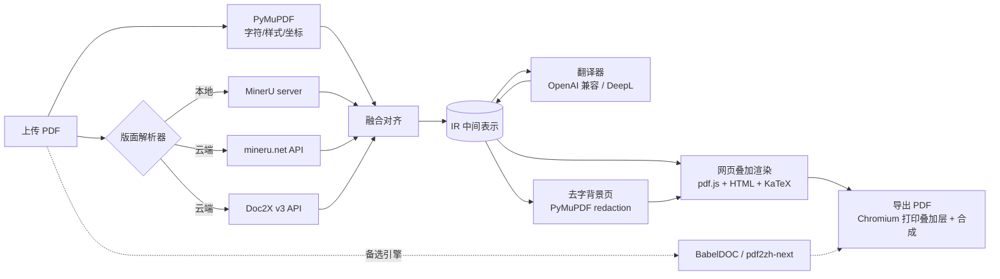

# 自建网页端 PDF 翻译 · 技术选型

> 日期：2026-10-28
> 依据：[00-research.md](00-research.md)
> 状态：草案，待 §8 的验证实验和 §9 的待确认问题落定后转为决策

---

## 1. 需求

| # | 需求 | 说明 |
|---|---|---|
| R1 | 网页端使用 | 上传 PDF → 浏览器里原文/译文对照阅读，类似沉浸式翻译 |
| R2 | 整体保留原版式 | 译文按原位置、原字号风格排回页面，图片和矢量图形不动 |
| R3 | 公式、图表重新渲染 | 公式不被翻坏；行内公式随译文重新排布；表格、图内文字可翻译并重新渲染 |
| R4 | 可接外部 API | 翻译：任意 OpenAI 兼容 LLM，可选 DeepL/Google；解析：MinerU（本地/云端）、Doc2X |
| R5 | 自用、非商用 | 可直接使用 AGPL 组件（PyMuPDF、BabelDOC）；单用户或少量用户 |
| R6 | 可导出 | 导出纯译文 PDF、双语对照 PDF |

非目标（当前阶段）：多租户、计费、公网 SaaS、Word/PPT 等非 PDF 格式。

---

## 2. 总体思路

调研结论是：**保版式 = 字符级坐标 + 版面语义 + 好的排版引擎**。三者分别交给最擅长的组件：

| 能力 | 交给谁 | 理由 |
|---|---|---|
| 字符级坐标、字体、字号、颜色 | **PyMuPDF**（原生文本 PDF） | 坐标直接来自 PDF，误差为 0；速度快 |
| 版面语义（块类型、阅读顺序、公式 LaTeX、表格结构、OCR） | **MinerU / Doc2X**（可插拔） | 模型识别，结构比规则可靠；扫描件也能处理 |
| 排版（换行、缩放、公式渲染） | **浏览器**（HTML/CSS + KaTeX） | 排版能力远强于在 PDF 里手写绘制指令，还能逐段编辑 |

两者融合后形成**自有中间表示（IR）**，解析器、翻译器、渲染器都围绕 IR 插拔：



**为什么不直接用 BabelDOC？** 它只产出 PDF，API 是内部接口，难以做网页上的逐段编辑、重翻、对照联动；只支持 OpenAI 兼容接口；也接不了 MinerU/Doc2X 的结构结果。但它效果是现成的，**作为基线和备选引擎接入**（自用不受 AGPL 影响）。

**为什么不走"转 Markdown 再翻"？** 丢原版式，不满足 R2。但 MinerU/Doc2X 的结构化结果（LaTeX、表格 HTML）正是 R3 需要的，所以只取它们的**结构**，不取它们的 Markdown 排版。

---

## 3. 技术栈总表

| 层 | 选型 | 备选 | 说明 |
|---|---|---|---|
| 后端语言 | **Python 3.12** + uv | — | PDF/解析生态全在 Python |
| Web 框架 | **FastAPI** + Pydantic v2 | Litestar | IR 直接用 Pydantic 模型定义，自带 JSON Schema，前端可生成 TS 类型 |
| 任务执行 | **SQLite 任务表 + 进程内 worker**（asyncio + ProcessPool） | Redis + arq / Celery | 自用规模不必上 Redis；接口抽象好，以后可替换 |
| 进度推送 | **SSE** | WebSocket | 单向推送足够，实现简单 |
| 数据库 | **SQLite**（SQLModel） | PostgreSQL | 任务、翻译缓存、术语表、API 配置 |
| 文件存储 | 本地目录 `data/jobs/<id>/` | MinIO | 原文件、IR、背景页、导出物 |
| PDF 读写 | **PyMuPDF** | pikepdf（底层修补） | 文字提取、去字、叠加合成、栅格化 |
| 版面解析 | **MinerU 4.0**（独立服务，本地或 `--remote`） | Doc2X v3-2026 API；PaddleOCR-VL（扫描件） | 适配器模式，见 §4.2 |
| 翻译 | **OpenAI 兼容客户端**（官方 `openai` SDK，自定义 base_url） | DeepL API、Google | 覆盖 DeepSeek、通义千问、GLM、Kimi、硅基流动、OpenRouter、Ollama、vLLM 等 |
| 前端框架 | **React + Vite + TypeScript** | Vue 3 | 生态和 pdf.js 集成资料最多 |
| PDF 渲染 | **pdfjs-dist**（直接用，不套 react-pdf） | — | 需要精确控制 viewport 和坐标换算 |
| 公式渲染 | **KaTeX** | MathJax 3 | 快、同步渲染、输出可打印；MathJax 覆盖面更广作兜底 |
| 状态/请求 | Zustand + TanStack Query | — | — |
| 样式 | Tailwind CSS | — | — |
| PDF 导出 | **Playwright（Chromium）打印叠加层** + PyMuPDF 合成 | PyMuPDF `insert_htmlbox` | 见 §5.3 |
| 字体 | Noto Sans/Serif CJK SC（思源） | 用户自定义 | 前端 @font-face 与导出共用同一字体 |
| 部署 | **Docker Compose**：`web`（Caddy）+ `app`（API+worker）+ `mineru`（可选，GPU） | — | Caddy 顺带做 Basic Auth |

---

## 4. 后端设计

### 4.1 IR（中间表示）

统一坐标：**PDF point，左上角原点**（与 PyMuPDF 一致）。MinerU/Doc2X 的坐标在适配器里换算（单位需验证，见 §8 S2/S3）。

```python
class Span(BaseModel):          # 来自 PyMuPDF，原生文本才有
    text: str
    bbox: Rect
    font: str
    size: float
    color: int
    flags: int                  # 粗体/斜体/上下标

class InlineFormula(BaseModel):
    id: str                     # 占位符 id，如 "m1"
    bbox: Rect
    latex: str | None           # 来自 MinerU/Doc2X
    crop: str | None            # 原图裁剪（兜底渲染）

class Block(BaseModel):
    id: str
    page: int
    type: Literal["text", "title", "list", "caption", "footnote",
                  "formula", "table", "figure", "header", "footer",
                  "reference", "code"]
    bbox: Rect
    order: int                  # 阅读顺序
    spans: list[Span] = []
    formulas: list[InlineFormula] = []
    latex: str | None = None    # 独立公式
    table_html: str | None = None
    style: BlockStyle           # 主字体、主字号、颜色、对齐、行距（由 spans 统计）
    translatable: bool

class Segment(BaseModel):       # 翻译单元，可跨栏/跨页合并多个 Block
    id: str
    block_ids: list[str]
    source: str                 # 含占位符：'如 <m1/> 所示，<b>重要</b>'
    target: str | None
    status: Literal["pending", "done", "failed", "edited"]

class Document(BaseModel):
    pages: list[Page]           # 每页宽高、旋转、blocks
    segments: list[Segment]
    meta: DocMeta               # 标题、语言、解析器、版本
```

IR 落盘为 `ir.json`，每个阶段只读写 IR，阶段之间可单独重跑（换翻译模型不必重新解析）。

### 4.2 解析适配器

```python
class LayoutParser(Protocol):
    name: str
    async def parse(self, pdf: Path, pages: range | None) -> LayoutResult: ...
```

| 适配器 | 何时用 | 备注 |
|---|---|---|
| `MinerULocal` | 默认；有 GPU 用 standard/advanced，无 GPU 用 basic + ONNX（CPU） | 以独立容器运行 `mineru server`，HTTP 调用，隔离重依赖 |
| `MinerUCloud` | 本机算力不够或想快速验证 | 需 `MINERU_API_KEY`；文件会上传云端 |
| `Doc2X` | 公式密集、要高质量 LaTeX | 按页付费 ¥0.01–0.02；v3-2026 返回带坐标的版面块；结果 24h 过期，立即取回 |
| `DocLayoutYOLO`（可选） | 纯离线、只要块类型不要 LaTeX | BabelDOC/pdf2zh 同款，ONNX 体积小 |

**融合对齐**（`fusion.py`）：

1. PyMuPDF `page.get_text("rawdict")` 取字符/span。
2. 版面块与 span 按 bbox 重叠率归属；未被任何块覆盖的 span 自成文本块（防漏翻）。
3. 块类型、阅读顺序、LaTeX、表格 HTML 取自解析器；文字内容和样式以 PyMuPDF 为准（原生 PDF）。
4. 行内公式：落在文本块内、被解析器标为公式的区域 → 生成 `InlineFormula` 和占位符。
5. 扫描件（无文本层）：退化为纯解析器结果，样式用估算值（字号 ≈ 行高 × 系数）。
6. 跨栏/跨页段落合并：上一块末尾无句末标点 + 下一块首字母小写/同字号 → 合并为同一 Segment。

### 4.3 翻译

```python
class Translator(Protocol):
    async def translate(self, batch: list[Segment], ctx: TranslateContext) -> list[str]: ...
```

- **OpenAI 兼容为主**：配置项只有 `base_url`、`api_key`、`model`、`max_concurrency`、`rpm`，能覆盖绝大多数国内外 LLM 和本地 Ollama/vLLM。
- **批量 + 上下文**：每次请求打包多个相邻 Segment（按 token 预算），要求 JSON 返回 `{id: 译文}`；系统提示词带文档标题、摘要、术语表。
- **占位符用 XML 风格**（`<m1/>`、`<b>…</b>`），比 `{v1}` 更不易被 LLM 改坏；返回后校验占位符集合一致，不一致单条重试，仍失败则标 `failed` 并保留原文。
- **术语表**：用户导入 CSV + 首轮自动抽取（让 LLM 从摘要/高频名词中提取，用户可审阅）。
- **缓存**：`sha256(source + model + prompt_version + glossary_hash)` → 译文，存 SQLite；重开同一文档、换渲染方式都不重复花钱。
- **限流与重试**：信号量控并发，令牌桶控 RPM，指数退避；记录每个任务的 token 用量。
- **API Key 存储**：放 `.env` 或 SQLite（本机加密），前端只显示掩码。

### 4.4 去字背景页

对每页所有 `translatable` 块：

```python
page.add_redact_annot(block.bbox)          # 只框文字块
page.apply_redactions(
    images=fitz.PDF_REDACT_IMAGE_NONE,     # 不动图片
    graphics=fitz.PDF_REDACT_LINE_ART_NONE,# 不动矢量线条（表格线、图表）
    text=fitz.PDF_REDACT_TEXT_REMOVE,      # 只删文字
)
```

输出 `background.pdf`：保留图片、矢量图、独立公式（公式块不删，原样保留最忠实），只抹掉要翻译的文字。注意按字符 bbox 判定，块框需略收缩，避免误删相邻公式字符。

### 4.5 API 概要

| 方法 | 路径 | 作用 |
|---|---|---|
| POST | `/api/jobs` | 上传 PDF + 选项（解析器、翻译服务、语言、页码范围） |
| GET | `/api/jobs/{id}/events` | SSE 进度（解析 → 融合 → 翻译 n/m → 背景页） |
| GET | `/api/jobs/{id}/ir` | 获取 IR（可按页分片） |
| GET | `/api/jobs/{id}/files/{name}` | 原文、背景页、导出物 |
| PATCH | `/api/segments/{id}` | 手动修改译文 |
| POST | `/api/segments/{id}/retranslate` | 单段重翻（可换模型/提示词） |
| POST | `/api/jobs/{id}/export` | 导出纯译文 / 双语 PDF |
| GET/PUT | `/api/settings/providers` | 管理外部 API 配置 |
| GET/PUT | `/api/glossaries` | 术语表 |

---

## 5. 前端与渲染

### 5.1 页面结构

```
┌──────────── 工具栏：缩放 / 双栏·单栏·只看译文 / 导出 / 设置 ────────────┐
│  原文（pdf.js 渲染 original.pdf）  │  译文（叠加渲染）                   │
│                                  │  ┌ Layer 0：pdf.js 渲染 background.pdf
│   悬停段落 ↔ 右侧对应段落高亮       │  └ Layer 1：绝对定位的译文 HTML 块
│   同步滚动                        │     点击 → 显示原文 / 编辑 / 重翻     │
└──────────────────────────────────┴──────────────────────────────────────┘
```

- 两侧都用 pdf.js 渲染，背景页是矢量 PDF，任意缩放都清晰。
- 只渲染可视区附近的页（虚拟列表），大文档不卡。
- 坐标换算：`css_px = pt × viewport.scale`，Layer 1 用一个 `transform: scale()` 容器整体缩放，块内部始终按 pt 排版，保证网页和导出一致。

### 5.2 公式与图表的渲染策略（R3）

| 元素 | 默认策略 | 备选 / 兜底 |
|---|---|---|
| **独立公式** | 不翻译，**保留原矢量**（背景页里本来就在） | 扫描件或原公式是低清图片时，用 LaTeX + KaTeX 重新渲染替换 |
| **行内公式** | 译文中的 `<m1/>` 替换为 **KaTeX 渲染的 LaTeX** | 无 LaTeX 或 KaTeX 报错 → 用原公式区域裁剪图（PyMuPDF 按 clip 高倍率栅格化）作为行内图片 |
| **表格（原生文本）** | 保留表格线（背景页），按单元格把译文叠回原位置 | 单元格放不下 → 该表整体改用解析器的 `table_html` 重新渲染为 HTML 表格 |
| **表格（扫描件）** | 用 `table_html` 翻译单元格后整体重新渲染 | — |
| **图片里的矢量文字**（坐标轴、图例） | 图区域内 PyMuPDF 能取到的 span 单独翻译，小字号叠加 | 可按文档开关关闭 |
| **图片里的栅格文字** | 后期：OCR 后叠加 | 当前不做 |
| **图注 / 表注** | 当普通文本块翻译 | — |

### 5.3 排版拟合（最容易出问题的环节）

每个译文块的目标是"放进原 bbox，且字号尽量接近原文"：

1. 初始字号 = 原文主字号，字体按原文衬线/无衬线映射到 Noto Serif/Sans CJK，粗体斜体沿用。
2. 先调行距（1.0–1.3 区间），再二分查找字号（下限 = 原字号 × 0.7），用离屏 DOM 测量实际高度。
3. 仍放不下 → **向下方空白扩展**：查同栏下方到下一个块之间的空隙，允许 bbox 下延（BabelDOC 的待做特性 "multi-available space typesetting"）。
4. 还放不下 → 触底字号 + 显示溢出标记，用户可点开看全文或手动编辑。
5. 拟合结果（字号、行距、扩展后 bbox）回写 IR，导出时直接复用，**不在导出端重新计算**，保证所见即所得。

### 5.4 导出 PDF

**主方案：Chromium 打印叠加层 + PyMuPDF 合成**

1. 后端起 Playwright，打开一个专用的导出页面，只渲染 Layer 1（透明背景、每页尺寸 = 原页 pt 尺寸、使用 IR 中的拟合结果）。
2. `page.pdf()` 输出 `overlay.pdf`（文字为矢量，Chromium 自动嵌入字体子集，KaTeX 公式也是矢量文字）。
3. PyMuPDF 逐页：`background_page.show_pdf_page(rect, overlay, i)` 把叠加层盖到去字背景页上 → **纯译文 PDF**，全程矢量。
4. 双语对照：新建双倍宽页面，左边 `show_pdf_page(original)`，右边贴纯译文页；或原文页、译文页交替。

优点：网页和导出共用同一套 HTML 渲染，所见即所得；公式、表格、复杂样式都能导出。

**备选方案：PyMuPDF `insert_htmlbox`**

不依赖浏览器，直接把译文 HTML 排进背景页 bbox（`scale_low` 控制缩放下限，`Archive` 加载 CJK 字体）。缺点是不支持 KaTeX，行内公式只能用裁剪图；排版结果和网页可能不一致。适合作为无头浏览器不可用时的兜底。

**备选引擎：BabelDOC**

导出选项里加"BabelDOC 引擎"，直接调用 pdf2zh-next / BabelDOC 生成 PDF，用于效果对比和兜底。

---

## 6. 部署

```yaml
# docker-compose.yml（示意）
services:
  web:      # Caddy：静态前端 + 反向代理 + Basic Auth
  app:      # FastAPI + worker + Playwright Chromium + 字体
    volumes: ["./data:/data"]
  mineru:   # 可选：mineru server；无 GPU 用 basic + ONNX；有 GPU 加 deploy.resources
```

- 自用场景通过 Caddy Basic Auth 或只在内网/Tailscale 访问即可，不做账号系统。
- 模型下载走国内镜像（`HF_ENDPOINT=https://hf-mirror.com` 或 ModelScope），构建时预拉，避免调研中最常见的"模型下载失败"。
- 字体打进镜像，不在运行时下载（同样是常见坑）。

---

## 7. 分阶段计划

| 阶段 | 内容 | 验收标准 |
|---|---|---|
| **P0 验证**（§8） | 跑通 6 个验证实验，选定解析器组合与导出方案 | 每个实验有结论写进文档 |
| **P1 MVP** | 上传 → PyMuPDF + MinerU → IR → OpenAI 兼容翻译 → 网页双栏对照；独立公式保留原样，行内公式用裁剪图 | 5 篇英文论文能完整翻译，无漏页，正文版式不乱 |
| **P2 可用** | KaTeX 行内公式、排版拟合与向下扩展、术语表、翻译缓存、单段编辑/重翻、导出纯译文和双语 PDF | 导出 PDF 与网页视觉一致；同一文档二次打开不再调用 LLM |
| **P3 增强** | 表格单元格翻译、图内矢量文字、Doc2X 适配器、跨页段落合并、DeepL 适配器 | 含表格的技术文档可用 |
| **P4 扩展** | 扫描件（MinerU OCR / PaddleOCR-VL）、BabelDOC 备选引擎、中译英方向优化、书签目录保留 | 白底扫描件可用 |

---

## 8. 待做的验证实验（P0）

样本：自选 8–10 个公开 PDF，覆盖单栏/双栏论文、公式密集、表格多、图表多、技术手册、扫描件各至少 1 个。

| # | 实验 | 要回答的问题 |
|---|---|---|
| S1 | 用 pdf2zh-next / BabelDOC 跑全部样本 | 现成方案做到什么程度？作为后续对比基线 |
| S2 | MinerU 4.0 本地（basic/standard）+ 云端跑同样样本 | **bbox 单位与坐标系**、块类型枚举、公式 LaTeX 和表格 HTML 字段名、CPU 耗时 |
| S3 | Doc2X v3-2026 API 跑 3 个公式密集样本 | 返回 JSON 的坐标格式；LaTeX 质量是否明显优于 MinerU |
| S4 | MinerU 块 ↔ PyMuPDF span 对齐 | 对齐准确率；漏归属 span 的比例 |
| S5 | PyMuPDF redaction 只删文字 | 是否误删公式字符、表格线；CID 字体页是否能处理 |
| S6 | Chromium 打印透明叠加层 + `show_pdf_page` 合成 | 输出是否全矢量、字体是否嵌入、坐标是否与网页一致、文件大小 |

---

## 9. 待确认问题

1. **硬件**：部署机器有没有 NVIDIA GPU、显存多大？决定 MinerU 用 basic（CPU）还是 standard/advanced（VLM）。
2. **文档类型**：主要是学术论文，还是技术手册、专利、扫描件？扫描件占比多少？
3. **语言方向**：只要英译中，还是也要中译英、日译中？（中译英的溢出问题更严重）
4. **使用人数**：只有自己，还是团队几个人共用？决定是否需要简单的账号隔离。
5. **云端解析可接受吗**：是否允许把文档上传到 mineru.net / Doc2X？涉密文档需强制走本地。
6. **代码仓库**：是否像 web-monitor 一样建 Git 仓库并推送到远端？

---

## 10. 风险

| 风险 | 影响 | 缓解 |
|---|---|---|
| MinerU 4.0 输出 schema 文档不全、版本变化快 | 适配器反复改 | 适配器内部做 schema 版本判断；锁定 MinerU 版本；S2 先摸清 |
| 行内公式与译文混排位置不准 | 公式错位、重叠 | 优先 KaTeX 重新渲染（随文字流动），而不是按原坐标贴 |
| 中译英 / 中日混排溢出 | 字号过小 | 向下扩展空白 + 字号下限 + 溢出标记 + 手动编辑 |
| CID 字体无法提取文字 | 漏翻 | 检测到乱码/空文本时该页走 OCR 路径 |
| LLM 改坏占位符或漏翻 | 公式丢失 | 占位符校验 + 单条重试 + 失败保留原文 |
| 云端 API 隐私 | 文档外泄 | 每次任务显式选择解析器；默认本地 |
| 许可 | 自用无影响；若将来对外提供服务，PyMuPDF/BabelDOC 的 AGPL 要求公开源码，MinerU 要求署名 | 文档中记录，开放前重新评估 |
