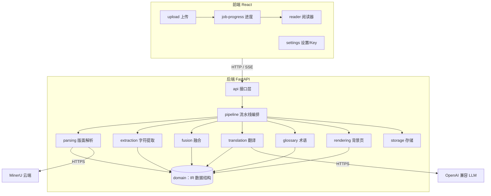
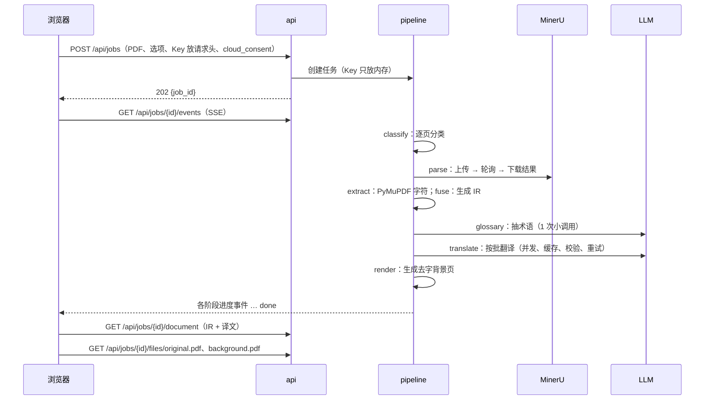

# MVP 第一阶段设计

> 日期：2026-10-28
> 依据：[01-tech-stack.md](01-tech-stack.md)（选型 v9）、[02-spikes.md](02-spikes.md)（S1–S12 实验结论）
> 状态：第一阶段已完成（v0.1.0），见 §7 开发记录
> 设计原则：**高内聚、低耦合**——每个模块只负责一件事，模块之间只通过稳定的接口（端口）和数据结构（IR）交互

---

## 1. 第一阶段范围

**目标**：上传一篇原生文本的英文论文 PDF，在浏览器里得到左右对照、保留版式的中文译文，可逐段修改和重翻。

| 包含（P1） | 不包含（后续阶段） |
|---|---|
| 原生文本 PDF，≤200 页（MinerU 单文件上限） | 扫描页 / 乱码页 OCR 路径与背景擦除（P3） |
| 版面解析：MinerU 云端精准解析 API（上传前确认） | Doc2X、本地解析（P2 / P4） |
| 翻译：任意 OpenAI 兼容接口；v2 提示词；默认不思考，可选“精翻”（思考·low） | DeepL、多模型对比（P2+） |
| 术语：文档术语抽取 + 程序校正 + GIST 词库匹配 | 用户术语表编辑界面、Wikidata 兜底（P2 / P4） |
| 翻译缓存、占位符校验、失败段重试 | |
| 网页阅读器：左原文 / 右译文（去字背景 + 叠加层 + KaTeX 行内公式），同步滚动、悬停联动 | 导出 PDF（P2） |
| 单段编辑、单段重翻 | 表格单元格翻译、图内文字（P3） |
| API Key 存浏览器 localStorage，随请求发送 | 账号系统 |
| Docker Compose 一键启动（web + app） | |

**验收标准**

1. S7–S12 用过的 5 篇 arXiv 论文都能完整走通：解析 → 翻译 → 阅读器展示，无漏页、无公式丢失（占位符校验 100% 通过或明确标出失败段）。
2. 公式密集页（1412.6980 第 2–3 页）排版不重叠，行内公式由 KaTeX 渲染，失败时回退为原图裁剪。
3. 一篇 15 页论文，DeepSeek 默认档费用空闲时段 ≤ ¥0.1、高峰时段 ≤ ¥0.15（M3 后调整：公式 LaTeX 给模型看提升了质量，也让费用高了约 70%），端到端耗时 ≤ 3 分钟（不含 MinerU 免费额度的排队时间，实测 26 秒到 4 分钟不等）。
4. 同一文档第二次打开不再调用 LLM；单段重翻只发这一段。
5. 机器 2 核 / 2 GB 内存可运行（轻量模式不在本地跑模型）。

---

## 2. 总体架构



### 2.1 依赖规则（保证低耦合）

```
api  →  pipeline  →  { parsing, extraction, fusion, translation, glossary, rendering }  →  domain
                ↘  storage（经端口）
```

- **domain** 只有数据结构和纯函数，不依赖任何其他模块、不做 IO。能力模块之间传递的中间结构（版面结果 `layout.py`、字符数据 `chars.py`）也放在 domain，否则产出方和消费方就得互相导入（M2 调整）。
- 六个能力模块**互不导入**：它们之间的数据只经 domain 的 IR 传递，由 pipeline 串起来。
- 能力模块对外部服务（MinerU、LLM、文件、数据库）只依赖自己声明的**端口（Protocol）**；具体实现（适配器）在启动时由 `container.py` 注入。
- api 只做“HTTP ↔ 用例”转换，不含业务逻辑。
- 违反规则的导入用 `import-linter` 在 CI 中检查。

### 2.2 一次翻译任务的时序



---

## 3. 后端设计

### 3.1 目录结构

```
backend/
  pyproject.toml                  # uv 管理；Python 3.12
  src/pdftr/
    domain/                       # 纯数据结构与纯函数
      geometry.py                 #   Rect、坐标换算（0–1000 归一化 ↔ pt）
      ir.py                       #   Document / Page / Block / Span / InlineFormula / Segment
      layout.py                   #   LayoutResult：解析器统一输出（parsing 产出、fusion 消费）
      chars.py                    #   CharPage：PyMuPDF 字符（extraction 产出、fusion 消费）
      text.py                     #   文字纯函数（坏字符判断等）
      ids.py                      #   稳定 ID 生成
    parsing/                      # 版面解析
      port.py                     #   LayoutParser 协议、LayoutResult
      mineru_cloud.py             #   MinerU 精准解析 API 适配器
      mineru_normalize.py         #   layout.json → LayoutResult（跨页合并块、discarded 中的脚注）
    extraction/                   # PyMuPDF 侧
      chars.py                    #   rawdict 字符/样式提取
      classify.py                 #   逐页分类 native / scanned / garbled
    fusion/                       # 融合为 IR
      relocate.py                 #   续行归位：把并进前一块的跨栏/跨页续行搬回占位块，建立 continues_from 链
      align.py                    #   字符归属到块（中心点 + 容差，S4 验证 99.8%）
      text_fix.py                 #   只修“确定坏了”的解析器文字（控制字符、替换符、私用区）
      style.py                    #   块主字号/字体/粗体统计
      build.py                    #   融合入口 fuse()：生成 Document 与 FusionReport
    glossary/                     # 术语
      port.py                     #   TermSource 协议
      extract.py                  #   LLM 抽取（TERMS_V3：领域 + 术语）
      normalize.py                #   程序校正：正文大小写、剔除章节名
      gist.py                     #   GIST 词库加载（首次启动下载）
      matcher.py                  #   Aho-Corasick 命中 + 简单词形归一
    translation/                  # 翻译
      port.py                     #   ChatModel 协议（complete(messages, options) → text, usage）
      openai_compat.py            #   OpenAI 兼容适配器（含 DeepSeek 思考开关方言）
      segmenter.py                #   IR → Segment（占位符 <mN/>、公式 LaTeX）
      prompt.py                   #   v2 提示词（RULES_V2）与批次消息组装
      batcher.py                  #   按 token 预算分批
      validate.py                 #   占位符集合校验、行号完整性
      service.py                  #   翻译用例：缓存 → 分批 → 并发 → 校验 → 重试 → 写回
      cost.py                     #   token 计价、费用预估
    rendering/
      background.py               #   去字背景页（redaction，S5 参数）
      crops.py                    #   行内公式原图裁剪（KaTeX 失败时兜底）
    pipeline/
      stages.py                   #   各阶段函数：输入/输出都是工件
      runner.py                   #   顺序执行、断点续跑、失败重试
      events.py                   #   进度事件总线（内存发布订阅）
      secrets.py                  #   任务级 Key 内存保管（任务结束清除）
    storage/
      port.py                     #   ArtifactStore、JobRepo、SegmentRepo、CacheRepo 协议
      files.py                    #   data/jobs/<id>/ 下的工件文件
      sqlite.py                   #   SQLModel 实现
    api/
      app.py                      #   FastAPI 应用、CSP 等中间件
      routes_jobs.py              #   任务：创建、查询、事件、文档、文件
      routes_segments.py          #   段落：编辑、重翻
      routes_meta.py              #   健康检查、模型列表、费用预估
      schemas.py                  #   请求/响应 DTO（与 IR 解耦）
      sse.py
    config.py                     # 环境变量配置（pydantic-settings）
    container.py                  # 组合根：创建适配器并注入
  tests/
    unit/  contract/  e2e/        # 见 §6
```

### 3.2 IR（domain/ir.py）

在 [01-tech-stack §4.1](01-tech-stack.md#41-ir中间表示) 的基础上，按实验结论补充字段。坐标统一为 **PDF point、左上角原点**。

```python
class Span(BaseModel):            # 块内按阅读顺序排列的片段
    kind: Literal["text", "formula"]
    text: str                      # kind=formula 时为空
    formula: str | None            # kind=formula 时为公式 key，如 "m1"
    line: int                      # 块内行号，拼接时判断换行与断词
    bbox: Rect
    font: str | None
    size: float
    color: int
    bold: bool
    italic: bool

class InlineFormula(BaseModel):
    key: str                       # "m1"
    latex: str                     # 来自 MinerU inline_equation
    bbox: Rect                     # 用于原图裁剪兜底

class Block(BaseModel):
    id: str                        # "p3-b12"
    page: int
    type: BlockType                # text / title / caption / footnote / formula / table / figure / code / header / footer / reference
    bbox: Rect
    order: int
    spans: list[Span] = []
    formulas: list[InlineFormula] = []
    latex: str | None = None       # 独立公式
    continues_from: str | None = None  # 跨栏/跨页段落：本块接在哪个块后面（M2：续行已搬回各自位置）
    style: BlockStyle
    translatable: bool
    orphan: bool = False           # 解析器漏掉、由未归属字符补出的块

class Segment(BaseModel):
    id: str
    job_id: str
    block_ids: list[str]           # 沿 continues_from 链合并的各块；渲染时按各块原文长度拆分译文
    source: str                    # 含 <mN/> 占位符
    formulas: dict[str, str]       # key → LaTeX（请求时展开成 <mN>LaTeX</mN>）
    section: str                   # 所在章节，作为批次上下文
    target: str | None = None
    status: SegmentStatus          # pending / done / failed / edited
    quality: Literal["default", "careful"] = "default"   # careful = 精翻（思考·low）

class Document(BaseModel):
    job_id: str
    pages: list[Page]              # 宽高、旋转、kind、blocks
    meta: DocMeta                  # 标题、摘要、领域、源语言、解析器、是否用了云端
```

IR 只描述“文档是什么”，不含任何服务调用细节；译文单独存 `segments` 表，IR 文件解析后不再改动。

### 3.3 端口（各模块对外的唯一依赖）

```python
# parsing/port.py
class LayoutParser(Protocol):
    name: str
    is_cloud: bool
    async def parse(self, pdf: Path, pages: list[int] | None) -> LayoutResult: ...

# translation/port.py
class ChatModel(Protocol):
    async def complete(self, system: str, user: str, opts: ChatOptions) -> ChatResult: ...
    # ChatOptions: model, temperature, max_tokens, thinking: off|low
    # ChatResult: text, usage(prompt/hit/miss/completion/reasoning)

# glossary/port.py
class TermSource(Protocol):
    def lookup(self, terms: Iterable[str]) -> dict[str, str]: ...

# storage/port.py
class ArtifactStore(Protocol):
    def path(self, job_id: str, name: str) -> Path: ...
class SegmentRepo(Protocol):
    def save_many(self, segs: list[Segment]) -> None: ...
    def pending(self, job_id: str) -> list[Segment]: ...
    def update_target(self, seg_id: str, target: str, status: SegmentStatus) -> None: ...
class CacheRepo(Protocol):
    def get(self, key: str) -> str | None: ...
    def put(self, key: str, target: str) -> None: ...
```

新增解析服务（Doc2X、本地 MinerU）或翻译服务，只需新增适配器并在 `container.py` 注册，其他模块不改。

### 3.4 流水线（pipeline）

| 阶段 | 输入工件 | 输出工件 | 来自实验 |
|---|---|---|---|
| `classify` | original.pdf | page_kinds.json | §4.2 规则；P1 遇到 scanned/garbled 页给出提示并跳过 |
| `parse` | original.pdf | parser/raw.zip、layout.json | S2：`model_version=vlm`、公式/表格开、>200 页分段 |
| `extract` | original.pdf | chars.json | S4 |
| `fuse` | layout.json、chars.json | ir.json | S4 对齐；续行归位（MinerU 的 `lines_deleted` 占位块）；只修确定坏了的文字 |
| `segment` | ir.json | segments 表 | S7 切分规则：参考文献默认不翻 |
| `glossary` | ir.json | glossary.json | S10：TERMS_V3 + 程序校正 + GIST 命中 |
| `translate` | segments、glossary | segments 表（译文） | S7/S9：v2 提示词、约 1500 token 一批、温度 0.3、默认不思考 |
| `render` | original.pdf、ir.json | background.pdf、crops/ | S5：`REMOVE_IF_TOUCHED` |

- 每个阶段是**纯粹的“读工件 → 写工件”函数**，彼此不直接调用；runner 记录 `job.stage`，失败时从失败阶段重跑（MinerU 结果和译文都已落盘，重跑不重复花钱）。
- 每个阶段向事件总线发布 `JobEvent(stage, progress, message)`，api 的 SSE 只订阅总线。
- 执行模型：单进程 asyncio worker；`translate` 内部按服务商配置的并发数和 RPM 限流（S7 用 4 并发）。

### 3.5 翻译用例（translation/service.py）

```
pending 段落
  → 查缓存（key = sha256(source + formulas + model + prompt_version + glossary_hash + quality)）
  → 未命中的按 token 预算分批（同一批注明章节）
  → 组装消息：system = RULES_V2 + 标题/摘要/领域 + 本批命中的术语；user = 「编号|带 LaTeX 的原文」
  → 并发调用 ChatModel（quality=careful 的批次开思考·low）
  → 解析「编号|译文」，校验行号与占位符集合
  → 通过：写回 + 写缓存；不通过：该段单独重试 2 次，仍失败标 failed（阅读器显示原文 + 重试按钮）
  → 汇总 usage 计算费用
```

档位按任务选择：默认不思考，“精翻”整篇开低强度思考（S10/S11 结论，“标准档”的混合规则已取消）。重试的最后一轮无论档位都开思考。

### 3.6 API（P1）

| 方法 | 路径 | 说明 |
|---|---|---|
| POST | `/api/jobs` | multipart：`file`、`options`（JSON：解析器、模型、档位、页码范围、是否翻参考文献、`cloud_consent`）；请求头 `X-LLM-Base-URL`、`X-LLM-Key`、`X-LLM-Model`、`X-Parser-Key`。返回 `202 {job_id}` |
| GET | `/api/jobs/{id}` | 状态、当前阶段、页数、费用、错误 |
| GET | `/api/jobs/{id}/events` | SSE：`{stage, progress, message}` |
| GET | `/api/jobs/{id}/document` | 阅读器数据：页面尺寸、块（bbox、类型、样式、跨页信息）、段落（原文、译文、状态、公式 LaTeX） |
| GET | `/api/jobs/{id}/files/{name}` | `original.pdf`、`background.pdf`、`crops/{key}.png` |
| POST | `/api/jobs/{id}/retry` | 从失败阶段重跑（需重新带 Key） |
| PATCH | `/api/segments/{id}` | 手动修改译文（status=edited，不会被后续重翻覆盖） |
| POST | `/api/segments/{id}/retranslate` | 单段重翻，可选 `quality=careful`；需带 Key |
| POST | `/api/estimate` | 页数/字数 → 预估 token 与费用 |
| GET | `/api/health` | 健康检查 |

DTO 定义在 `api/schemas.py`，由 IR 转换而来；前端类型由 OpenAPI 生成（`openapi-typescript`），前后端只通过这份契约耦合。

### 3.7 存储

```
data/
  app.db                              # SQLite：jobs、segments、translation_cache、glossary_entries
  jobs/<job_id>/
    original.pdf
    page_kinds.json  chars.json  layout.json  ir.json  glossary.json
    parser/raw.zip                    # MinerU 原始结果，便于重放
    background.pdf
    crops/m*.png
  glossaries/vendor/gist_zh.csv       # 首次启动下载（Apache-2.0，保留署名）
```

### 3.8 安全与隐私

- Key 只在请求头中出现，后端放在 `pipeline/secrets.py` 的内存字典里（按 job_id），任务结束或失败即清除；日志过滤 `X-*-Key` 请求头。
- `cloud_consent` 为假时拒绝使用云端解析器（422）。
- 上传限制：200 MB、200 页、仅 `application/pdf`；文件名不入路径（用 job_id）。
- 严格 CSP，前端不加载第三方脚本（KaTeX、pdf.js 打包进前端资源）。

---

## 4. 前端设计

### 4.1 目录结构（按功能切片）

```
frontend/
  src/
    app/                    # 路由、全局 Provider（QueryClient）、布局
    pages/
      HomePage.tsx          #   上传 + 最近任务
      JobPage.tsx           #   进度 → 完成后切到阅读器
    features/
      upload/               # 上传区、选项面板、云端上传确认、费用预估
      job-progress/         # SSE 订阅、阶段进度条、失败重试
      reader/               # 阅读器（见 4.2）
      segment-edit/         # 段落弹出层：原文/译文、编辑、重翻
      settings/             # 服务配置：Base URL、模型、Key（localStorage）、默认档位
    entities/
      document/             # 文档/段落类型（由 OpenAPI 生成）与选择器
      job/
    shared/
      api/                  # fetch 客户端（自动附加 Key 请求头）、SSE 封装
      pdf/                  # pdfjs-dist 封装：加载、按页渲染、视口换算
      math/                 # KaTeX 渲染 <mN/>，失败回退裁剪图
      fit/                  # 文本拟合：先调行距、再二分字号（S5 的 FIT_JS 移植）
      storage/              # localStorage 安全读写（try/catch）
      ui/                   # 按钮、对话框等基础组件
```

**依赖规则**：`pages → features → entities → shared`，只能向下依赖；features 之间不互相导入（需要协作时通过 pages 组合或共享 store）；用 ESLint `import/no-restricted-paths` 检查。

### 4.2 阅读器（features/reader）

```
ReaderView
 ├ Toolbar          缩放、单栏/双栏/只看译文、跳页
 ├ SyncScroller     左右两栏按页对齐的同步滚动
 │ ├ OriginalPane   pdf.js 渲染 original.pdf（虚拟列表，只渲染可视区 ±2 页）
 │ └ TranslatedPane
 │    ├ BackgroundLayer   pdf.js 渲染 background.pdf
 │    └ OverlayLayer      绝对定位的译文块（pt 坐标 × 缩放），KaTeX 行内公式，拟合字号
 └ HoverLink        悬停任一侧的块 → 两侧对应块高亮；点击译文块打开 segment-edit
```

- **坐标**：容器内部始终用 pt 排版，外层整体 `transform: scale(zoom)`，保证不同缩放下排版一致（也为 P2 的导出复用同一套 HTML）。
- **跨页段落**：一个段落的各块按原文长度占比，在标点处拆分译文，分别放进各自位置（S5b 已验证拆分方法）。
- **拟合**：每块渲染后在 `requestAnimationFrame` 中计算一次，结果缓存在内存，缩放时不重算。
- **状态**：`failed` 段显示原文（灰色）+ 重试按钮；`edited` 段右上角小标记。

### 4.3 设置与 Key

- 设置页保存：翻译服务（预设 DeepSeek / OpenAI 兼容自定义）、Base URL、模型、Key、默认档位、MinerU Token。
- 全部存在 localStorage（`shared/storage` 封装，读写失败时退回内存），提供“清除已保存的 Key”。
- `shared/api` 在每个请求上附加对应请求头；没有配置时，上传页引导去设置。

### 4.4 上传页的云端提醒

- 常驻提示条：“文件将上传至 MinerU 云端进行版面解析，请勿上传涉密或未公开文档”。
- 提交前必须勾选确认（`cloud_consent=true`）。
- 显示预估：页数、预计费用（调用 `/api/estimate`）、预计耗时。

---

## 5. 部署

```yaml
# deploy/docker-compose.yml
services:
  app:
    build: ../backend          # Python 3.12 + PyMuPDF；P1 不含 Chromium
    volumes: ["../data:/data"]
    environment: [DATA_DIR=/data]
  web:
    build: ../frontend         # 构建静态文件，由 Caddy 提供
    ports: ["8080:80"]         # Caddy：静态资源 + /api 反向代理 + 可选 Basic Auth
```

---

## 6. 测试策略

| 层 | 内容 | 依赖 |
|---|---|---|
| 单元 | geometry 换算、segmenter 占位符、validate、batcher、prompt 组装、术语校正与匹配、fit 算法（前端 vitest） | 无外部依赖 |
| 契约 | `mineru_normalize` 用 S2 录制的 layout.json 作夹具；`openai_compat` 用 `spikes/mock_llm.py` 作假服务 | 本地夹具 |
| 融合回归 | 5 篇论文的对齐覆盖率 ≥99.5%、跨页段落数、块类型统计与 S4 一致 | 夹具（论文 PDF 由脚本下载，不入库） |
| 端到端 | 上传 → 假 LLM 翻译 → document 接口返回完整段落；前端 Playwright 打开阅读器截图比对 | Docker |
| 翻译质量 | 改提示词/模型时手动运行 S10/S11 回归脚本 | 真实 Key，不进 CI |

CI：GitHub Actions 跑 ruff、pyright、import-linter、pytest（单元 + 契约 + 融合回归）、前端 lint/typecheck/vitest/build。

---

## 7. 开发记录

**M2（2026-10-28）**：5 篇论文融合回归全部通过（覆盖率 99.84%–100%，续接链 6/10/5/13/10 条，无未归属的续行）。实现中的两处调整：

1. **续行归位**：MinerU 把跨栏/跨页段落的续行并进前一块，原位置留下 `lines_deleted` 占位块。原设计是记录“拆分比例”，改为把续行搬回占位块并用 `continues_from` 串链——每个块的文字都在自己的坐标里，渲染更简单。
2. **文字纠正收窄**：试过“与 PDF 文字相似就替换”，能修好 `ε`、`L2` 等个别错误，但也会把相邻行公式的重音符、求和号拼进正文，或丢掉单独成行的章节编号。改为只修含控制字符/替换符/私用区字符的文字（5 篇共 2 处）；“≲ 1 识别成 b1”这类看似正常的识别错误留作已知问题。

**M3（2026-10-28）**：真实 DeepSeek 翻译 3 篇论文，全部段落通过占位符校验（0 失败）。

| 论文 | 段落 | 请求 | 输入 / 输出 token | 费用（空闲 / 高峰估算） |
|---|---|---|---|---|
| Adam（15 页，255 个行内公式） | 95 | 9 | 24.5k / 8.9k | ¥0.056 / ≈¥0.11 |
| Transformer（15 页） | 113 | 6 | 14.2k / 5.7k | ¥0.035 / ≈¥0.07 |
| BERT（16 页） | 195 | 10 | 23.1k / 11.2k | ¥0.064 / ≈¥0.13 |

实现中的调整：

1. **大模型端口放进 domain**（`domain/llm.py`）：翻译和术语抽取都要调用模型，而两者不能互相导入。翻译缓存的端口留在 translation，由 storage 按结构实现。
2. **序数“公式”还原成文字**：MinerU 会把 `1^{st}`、`2^{nd}` 识别成公式，模型正确地译成“一阶”“二阶”，占位符随之消失、校验失败。切分时把这类公式直接写成 `1st`。
3. **重试策略**：首轮不合格的段落成批重试（每个请求带约 1000 token 固定提示，逐段重试曾让 Adam 的请求数到 21、输入 37.6k）；最后一轮逐段发送并开低强度思考——公式密集的段落挤在一批里容易编号错位，单独发送加思考就能通过。
4. **只保留 httpx2**：openai SDK 与 Starlette 已改用 httpx2，项目统一使用它，去掉 httpx。
5. **费用比 S7 高约 70%**：S7 实测 Adam 高峰 ¥0.066，现在约 ¥0.11。原因是 S9 采纳的“公式 LaTeX 给模型看”（输入多约 58%）和更完整的上下文（摘要、领域、30 余条术语、每批命中的词库术语）。这是用费用换质量的已知取舍；公式密集或较长的论文在高峰时段会略超“每篇 ≤ ¥0.1”的验收线。

**M4（2026-10-28）**：流水线、存储与全部第一阶段接口完成；假解析器 + 假模型的端到端接口测试覆盖上传、进度推送、阅读器数据、编辑、重翻、公式裁剪图、错误与断点重试。

1. **段落增加 `parts` 与 `formula_refs`**：切分时记录每块原文长度、每个公式所在页与位置，前端拆分跨页译文、KaTeX 失败时裁剪原图都不用再推算。
2. **任务与段落存 SQLite**（与译文缓存同库），段落整体存 JSON；服务重启时把进行中的任务标记为失败，用户重新提供 Key 后从断点继续。
3. **重翻不走缓存**：用户点“重翻”要的是另一个译文。
4. **发现的问题**：同步写法的“重试”接口在线程池里执行，没有事件循环，无法创建后台任务——改为异步接口（端到端测试发现）。

**M5（2026-10-28）**：前端上传、设置、进度、阅读器、段落编辑完成，用真实 Transformer 任务在浏览器中验证（加载 1 秒、无控制台错误）。

1. **阅读器改为“每页一行、原文译文并排、共用一个滚动条”**，代替两个独立滚动区再同步，天然对齐、没有滚动事件互相触发的问题。
2. **Key 注入用依赖倒置**：接口客户端在 shared 层，只暴露 `setAuthHeaders`，由 app 层把 entities 里的设置接上，shared 不依赖上层。
3. **前后端契约**：前端类型由 OpenAPI 生成（`npm run gen:api`，openapi-typescript 尚不支持 TypeScript 6，用 npx 独立运行）；后端测试检查前端提交的 openapi.json 与接口一致。
4. **按需加载**：阅读器连同 pdf.js、KaTeX 按需加载，首页脚本从 1 MB 降到 360 KB。
5. **浏览器实测发现并修复**：
   - MinerU 文字里的 `<sup>`/`<sub>` 被当成文字显示——改为白名单标签渲染成真实元素，其余标签仍按文字转义；
   - 首页作者、单位、邮箱块被翻译后挤成一团——标题与“Abstract”之间的正文块保留原文（5 篇论文都识别正确）；
   - pdf.js 6 去掉了 `isEvalSupported`，改用 `useWasm: false`（不放宽 CSP）。
6. **开发环境注意**：本机内存紧张时 Chromium 会长时间卡在加载中（可用内存一度只剩 115 MB），并非前端问题。

**M6（2026-10-28）**：Docker 部署验收、文档完善，发布 v0.1.0。

**验收结果**

| # | 标准 | 结果 |
|---|---|---|
| 1 | 5 篇论文完整走通，无漏页、公式不丢 | ✅ 5 篇全部完成：Adam（浏览器全流程）、ResNet、BERT、BabelDOC（Docker 部署 + 接口）、Transformer（本地后端 + 接口）；共 645 段，仅 Adam 1 段未通过占位符校验（界面标出、可重翻） |
| 2 | 公式密集页不重叠，KaTeX 渲染，失败回退裁剪图 | ✅ Adam 第 2–3 页正常；KaTeX 渲染失败数 0（S5b、M5 浏览器实测） |
| 3 | 费用空闲 ≤ ¥0.1、高峰 ≤ ¥0.15；不含排队 ≤ 3 分钟 | ✅ 空闲时段每篇 ¥0.033–0.073；Adam 浏览器全流程 99 秒（含 MinerU） |
| 4 | 第二次打开不调用模型；单段重翻只发这一段 | ✅ 译文缓存与段落存储；重翻接口只翻一段且不走缓存 |
| 5 | 2 核 2 GB 可运行 | ✅ 后端容器翻译时内存峰值 236 MB，前端容器约 50 MB |

部署中发现并修复：

1. **后端镜像 1.24 GB → 749 MB**：`uv sync` 的下载缓存被打进了镜像层，改为 `UV_NO_CACHE=1`；去掉实际未使用的 sqlmodel。PyMuPDF 2.0 自带 onnxruntime/numpy 依赖（约 140 MB），暂保留。
2. **网络错误提示**：容器无法访问外网时原先显示“内部错误”，改为“无法连接 MinerU 云端，请检查服务器网络”。
3. **主机网络模式**：本机 Docker 桥接网络不能访问外网（`IPv4 forwarding is disabled`），新增 `deploy/docker-compose.hostnet.yml`，Caddy 的监听地址与后端地址改为可用环境变量覆盖（默认值不变）。

**公网部署前加固（2026-10-28）**：完全公开部署前补上三项。

1. **不提供任务列表**：原来的 `GET /api/jobs` 会返回所有人的任务，公开后任何人都能看到别人的文件名并打开译文。改为前端在浏览器里记住自己创建的任务 ID（64 位随机数，相当于访问凭证），服务端只按 ID 查询；新增删除任务接口。
2. **自动清理**：任务文件、段落与译文缓存保留 `PDFTR_RETENTION_DAYS` 天（默认 7），启动时和之后每小时清理；进行中的任务不删。
3. **过载保护**：排队任务超过 `PDFTR_MAX_QUEUED_JOBS`、或磁盘剩余低于 `PDFTR_MIN_FREE_DISK_MB` 时拒绝上传（503）。
4. **MinerU 网络重试**：公网实测时容器到 mineru.net 的连接偶发 15 秒以上超时（3 次里 1 次），一次失败就让整个任务失败。改为连接超时 15 秒，网络错误按 2/5/10 秒退避重试 3 次；HTTP 错误码不重试。

公网实例：本机通过 Cloudflare 快速隧道（systemd 服务 `pdftr-tunnel`）对外，Docker 用主机网络模式；上传上限 50 MB / 100 页，不配置共享 Key。实测 10 页论文 145 秒完成、¥0.033，进度推送（SSE）经隧道实时到达。

**上线后改进（2026-10-28）**

1. **进度可见**：用户反馈任务页“不显示进展”。实测推送通道（经 Caddy 压缩、经隧道）都正常，原因是 MinerU 排队约 10 分钟期间页面毫无变化。改为把 MinerU 的排队、逐页解析（第 x/y 页）状态推送给前端，记录各阶段开始时间并显示“已等待多久”，无比例时显示扫动条，并提示高峰排队可能超过 10 分钟、可以关闭页面。
2. **下载 PDF**（原计划 P2，提前做）：服务端用 PyMuPDF 在去字背景页上排入译文（行内公式用原文裁剪图），双语版左原文右译文。原计划的 Chromium 打印方案在 2 核 4 GB 的机器上内存不够；PyMuPDF 的 `insert_htmlbox` 每次调用都嵌入一整份中文字体（17 页论文内存超过 1 GB），改为每页共用一个 `DocumentWriter` 并做字体子集化后：17 页约 1 秒、峰值约 190 MB、文件与原文大小相当。已知不足：部分较高的行内公式图会顶到上下行，表格标题偶有与表线重叠。
3. **界面重新设计**：“校样台”方向——灰绿桌面上的白纸页面，原文与译文像对开页、中间有装订线；首页上传区画成对开页，阅读器沿用同样的装订线；选中与悬停用校对蓝铅笔色。设置改为右侧抽屉。

## 8. 开发顺序（第一阶段内部里程碑）

| 步骤 | 内容 | 完成标志 |
|---|---|---|
| M1 骨架 | 仓库目录、uv/Vite 工程、CI、domain 模型、container、健康检查、Docker Compose | `docker compose up` 后访问首页和 `/api/health` |
| M2 解析与融合 | parsing（MinerU 云端）、extraction、fusion、classify；把 spike 代码整理成模块 | 5 篇论文生成 ir.json，融合回归测试通过 |
| M3 翻译 | segmenter、prompt v2、batcher、validate、openai_compat、缓存、费用；glossary | 假 LLM 端到端通过；真实 DeepSeek 跑一篇费用 ≤ ¥0.1 |
| M4 背景页与 API | rendering、pipeline runner、事件、全部 P1 接口 | 用 curl 走通一次完整任务 |
| M5 前端 | 上传、设置、进度、阅读器、段落编辑 | 浏览器中完成验收标准 1–4 |
| M6 收尾 | README 部署说明、错误提示、性能检查（2 核 2 GB） | 验收标准 5，打 `v0.1.0` 标签 |

每个里程碑完成后提交并推送；spike 代码保留在 `spikes/` 作为参考，正式代码不导入 spike。
